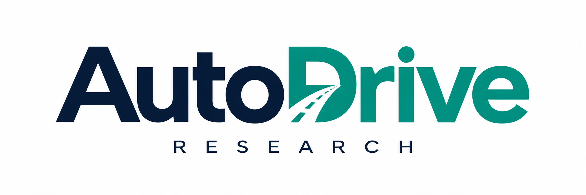

<strong>A research map for autonomous driving.</strong> Explore papers, implementations, datasets, and evaluation benchmarks.

<strong>468</strong> papers &nbsp;·&nbsp; <strong>46</strong> datasets &nbsp;·&nbsp; <strong>8</strong> benchmarks Updated 2026-11-27 · Verified paper &amp; author links

<a href="#industry-research-news">News</a> &nbsp;/&nbsp; <a href="#papers">Papers</a> &nbsp;/&nbsp; <a href="#public-datasets">Datasets</a> &nbsp;/&nbsp; <a href="#public-evaluation-benchmarks">Benchmarks</a> &nbsp;/&nbsp; <a href="#leaderboard">Leaderboard</a> &nbsp;/&nbsp; <a href="CONTRIBUTING.md">Contribute</a>

> **Community** · [Join our WeChat group](assets/branding/wechat-group-20261124.png) for paper discussions and research exchange.
>
> Open the invitation image and scan it in WeChat. Valid before December 1, 2026.

## Industry Research News

<strong>Company research</strong> · 17 reports · 1 series paper · 1 project preview

**On our radar** · Xiaomi · XPeng · NIO · Momenta · Horizon Robotics · ByteDance · Alibaba · Li Auto · Zhuoyu Technology (ZYT) · NVIDIA · Tesla

Since 2026-01-01 · Reports and series papers link to a research track. Dates use the first arXiv submission or the labeled official release date.

| Date | Company | Research highlight | Links |
|:---|:---|:---|:---:|
| 2026-11-26 Report release | **Horizon Robotics** | [**EponaX**](#driving-world-models) Surround-view world-action training and onboard trajectory planning tested on public roads. | &nbsp; |
| 2026-11-24 Announcement | **XPeng** | **WorldGPT** Project preview · Report pending · Cross-embodiment world-action model with driving evaluation and demonstrations. |  |
| 2026-11-19 | **XPeng** | [**TuringPAI**](#vision-language-action-models) Draft report: a compact vision-language foundation for onboard driving. |  |
| 2026-11-08 | **Xiaomi** | [**DriveFoundry**](#vision-language-action-models) Draft report: co-evolving driving data and Xiaomi-Drive-o1 with adaptive reasoning. | &nbsp;&nbsp; |
| 2026-11-04 | **NVIDIA** | [**Cosmos Interactive World Simulation**](#driving-world-models) Streaming simulation produces synchronized camera views and LiDAR for driving environments. | &nbsp;&nbsp; |
| 2026-11-01 | **Xiaomi** | [**Xiaomi Auto World Model 2.0**](#driving-world-models) Streaming multi-view simulation with persistent 3D scene context. | &nbsp; |
| 2026-10-31 | **XPeng** | [**X-World 1.6**](#driving-world-models) Controllable virtual cities with multi-camera consistency and long-rollout generation. | &nbsp; |
| 2026-09-18 | **Zhuoyu Technology (ZYT)** | [**ZYT-World**](#driving-world-models) One-step seven-camera simulation with controllable traffic and memory across revisits. | &nbsp; |
| 2026-09-05 | **Xiaomi** | [**DriveZero**](#recursive-self-improvement-for-autonomous-driving) Closed-loop reinforcement learning and teacher distillation beyond human driving demonstrations. | &nbsp;&nbsp; |
| 2026-08-31 | **Alibaba** | [**Qwen-Drive-1.0**](#vision-language-action-models) Unified 3D perception, driving question answering and planning. | &nbsp; |
| 2026-08-11 | **XPeng** | [**XCoT-VLA**](#vision-language-action-models) Executable reasoning tokens directly condition efficient driving trajectory generation. |  |
| 2026-06-27 | **XPeng** | [**X-Mind**](#vision-language-action-models) Compact visual reasoning rolls out future scenes before planning driving actions. | &nbsp; |
| 2026-06-02 | **NVIDIA** | [**Cosmos-Dreams (OmniDreams)**](#driving-world-models) Real-time action-conditioned video generation for reactive closed-loop driving simulation. | &nbsp;&nbsp; |
| 2026-06-01 | **NVIDIA** | [**Cosmos 3**](#driving-world-models) Omnimodal world model with driving-scene reasoning and world-scenario-map-conditioned video generation. | &nbsp;&nbsp; |
| 2026-05-24 | **XPeng** | [**X-Foresight**](#driving-world-models) Joint future-video and driving-action forecasting embeds predictive world knowledge in VLA. |  |
| 2026-05-18 | **Xiaomi** | [**Xiaomi EV World Model**](#driving-world-models) Joint reconstruction and generation for consistent multi-view driving simulation. |  |
| 2026-05-14 | **Horizon Robotics** | [**EponaV2**](#driving-world-models) Series paper · The EponaX predecessor predicts future geometry and semantics to improve trajectory planning. | &nbsp; |
| 2026-04-22 | **XPeng** | [**X-Cache**](#driving-world-models) Cross-chunk block caching accelerates few-step autoregressive driving world models. |  |
| 2026-03-20 | **XPeng** | [**X-World**](#driving-world-models) Controllable multi-camera world simulation for closed-loop driving development. |  |

[Sources & coverage](data/industry-news.json) · Watchlist membership does not imply a verified paper entry.

## Research Tracks

| [**E2E**](#end-to-end-autonomous-driving) | [**VLA**](#vision-language-action-models) | [**World Models**](#driving-world-models) | [**RSI**](#recursive-self-improvement-for-autonomous-driving) | [**Perception**](#perception--other-driving-research) |
|:---:|:---:|:---:|:---:|:---:|
| 118 papers | 131 papers | 136 papers | 37 papers | 46 papers |

<strong>Resource Guide</strong> · Datasets, evaluation protocols, and tools

E2E: end-to-end driving. VLA: vision-language-action models. RSI: explicit iterative self-improvement loops. Perception includes supporting driving research.

**Datasets** · [Perception and Multimodal Understanding](#perception-and-multimodal-understanding) · [Motion, Planning, and Cooperative Driving](#motion-planning-and-cooperative-driving) · [Simulation and Synthetic Data](#simulation-and-synthetic-data)

**Benchmarks** · [Closed-Loop Planning](#closed-loop-planning) · [Open-Loop and Non-Reactive Planning](#open-loop-and-non-reactive-planning) · [VLA and Driving Reasoning](#vla-and-driving-reasoning) · [Reliability and Robustness](#reliability-and-robustness)

[Paper Studio](paper-studio/README.md) · Local paper-to-WeChat workspace ([noncommercial source license](paper-studio/LICENSE)).

[Link audit](data/github-audit.json) · [Discovery history](data/adfeed-audit.json) · [Media discoveries](data/media-discovery-audit.json) · [License](#license)

## Papers

 Paper ·  GitHub ·  Project ·  Pending ·  Partial. Missing links are omitted.

Newest first · 2024 and earlier grouped together · Dataset names verified against papers; unknowns left blank.

### End-to-End Autonomous Driving

_118 papers; 60 with a verified public code link._

<strong>2026</strong> · 63 papers

| **Method / Paper** | **Venue** | **Focus** | **Datasets** | **Links** |
|---|---|---|---|:---:|
| **Recoverability Policy Editing** Recoverability policy editing for closed-loop safety in autonomous driving | arXiv 2026 | Closed-Loop Safety · Policy Editing · Recoverability | nuPlan |  |
| **CoSel** CoSel: Cooperation as Selection for End-to-End Driving | arXiv 2026 | Cooperative Driving · Trajectory Selection | V2Xverse, MDrive |  |
| **P2-TTA** Coordinating Perception and Planning for Test-Time Adaptation in End-to-End Driving under Distribution Shifts | arXiv 2026 | Test-Time Adaptation · Distribution Shift |  |  |
| **AgentMoT** AgentMoT: An Agentic Mixture-of-Transformers for End-to-End Autonomous Driving | arXiv 2026 | Mixture of Experts · Adaptive Computation | Bench2Drive v0.0.3, Bench2Drive v0.0.4 |  |
| **DriveTTO** DriveTTO: Understanding Search and Selection in Test-Time Trajectory Optimization for End-to-End Driving | arXiv 2026 | Test-Time Optimization · Trajectory Selection | NAVSIM v1, NAVSIM v2, HUGSIM | &nbsp;&nbsp; |
| **PlanNudge** Your Diffusion-Based Driving Planner Only Needs a Nudge | arXiv 2026 | Residual Planning · Reinforcement Learning | nuPlan | &nbsp; |
| **Geographic Overlap in Driving** Don't Test Where You Trained: Geographic Overlap Inflates End-to-End Driving Scores | arXiv 2026 | Geographic Generalization · Evaluation Leakage | NAVSIM v1, nuScenes |  |
| **Trailblazer-F** Trailblazer-F: Speculative Action-Flow Inference for Autonomous Driving | arXiv 2026 | Speculative Inference · Efficient Planning | NAVSIM v1 | &nbsp; |
| **DriveSTA** Beyond a Single Human Demonstration: Learning from Scored Trajectory Alternatives for End-to-End Driving | arXiv 2026 | DriveSTA · End-to-End Planning | NAVSIM v1, NAVSIM v2, HUGSIM | &nbsp;&nbsp; |
| **BADAS-3.0** BADAS-3.0: Real-Time Driving Perception and Planning from One Camera | arXiv 2026 | Single-Camera Planning · Collision Anticipation · Ego-Motion | nuScenes, Argoverse 2 Sensor, Argoverse 2 TbV, Waymo Open Dataset, PhysicalAI-AV, KITTI, Nexar Public, DAD, DoTA, DADA-2000, DCA-Bench, Euro NCAP benchmark, NAVSIM |  |
| **DRIFT** DRIFT: Detachable Reasoning for Runtime-Flexible and Efficient End-to-End Driving | arXiv 2026 | Detachable Reasoning · Reasoning Distillation · Closed-Loop Planning | LEAD, Bench2Drive, NAVSIM, AlpaSim | &nbsp;&nbsp; |
| **Improving While Deployed** Improving While Deployed: Learning Proactive End-to-End Driving from Imperfect Human Takeover Data | arXiv 2026 | Human Takeover Data · Offline Post-Training · Trajectory Scoring |  |  |
| **Lao Siji** Lao Siji: Adapting openpilot to Closed-Loop End-to-End Driving in Neural Reconstruction | arXiv 2026 | Closed-Loop Post-Training · Neural Reconstruction · Route Memory | PhysicalAI-AV, AlpaSim, HUGSIM, Odyssey, NAVSIM |  |
| **RiSE-Drive** RiSE-Drive: Risk-Sensitive Long-Horizon Candidate Evaluation for End-to-End Autonomous Driving | ACM MM 2026 | Trajectory Scoring · Distributional Evaluation · Tail-Risk Control | NAVSIM v1, NAVSIM v2, HUGSIM |  |
| **Latent-WAM++** Latent-WAM++: Shaping World and Action Representations for End-to-End Autonomous Driving | arXiv 2026 | World-Action Modeling · Geometric Priors · MeanFlow Planning | NAVSIM v2, HUGSIM |  |
| **BEVCast** BEVCast: Path-Adaptive BEV for Efficient End-to-End Autonomous Driving | arXiv 2026 | Adaptive BEV Resolution · Efficient Planning · Path-Guided Refinement | nuScenes, NAVSIM |  |
| **RFWorld** Trajectory Evaluation via Rollout-Free World Model for End-to-end Autonomous Driving | arXiv 2026 | Trajectory Scoring · Shared Scene Memory · Rollout-Free Evaluation | NAVSIM, Bench2Drive |  |
| **ManeuverFlow** ManeuverFlow: Maneuver Hypothesis Generation with Future Evidence for Trajectory Evaluation and Refinement in End-to-End Autonomous Driving | arXiv 2026 | ManeuverFlow · End-to-End Planning | NAVSIM v1, NAVSIM v2, WorldEngine | &nbsp; |
| **DriftingPlanner** DriftingPlanner: Drifting Generative Models for One-Step Trajectory Planning in End-to-End Autonomous Driving | arXiv 2026 | Drifting Models · One-Step Planning · Antithetic Sampling | NAVSIM |  |
| **CLAP-AD** Closed-Loop Aware Planning via Imitation-Free Speed Scoring for End-to-End Autonomous Driving | WACV 2027 | End-to-End Driving · Speed Control · Trajectory Scoring · Safety Constraints | Bench2Drive-Speed, Bench2Drive, NAVSIM v2 | &nbsp;&nbsp; |
| **Model-Aware Safety-Critical Scenes** Model-Aware Generation of Safety-Critical Scenes for Robust End-to-End Driving via Distilled Planner Surrogates | 2026 | Adversarial Scene Generation · Planner Distillation · Data Augmentation · Policy Improvement | nuScenes, NeuroNCAP, Challenger |  |
| **Expand-and-Prune** Expand-and-Prune: Test-Time Candidate-Space Adaptation for End-to-End Autonomous Driving | WACV 2027 | Test-Time Adaptation · Candidate Expansion · Uncertainty-Aware Pruning | LangAuto, Bench2Drive, Fail2Drive, NAVSIM v2 | &nbsp; |
| **VITAL** VITAL: From Visual Motion to Precise Action | 2026 | Action Tokenization · Flow Matching · Visual Motion · Residual Refinement | NAVSIM v1, NAVSIM v2 | &nbsp;&nbsp; |
| **AutoAgent0** AutoAgent0: An Agentic Runtime for Safe Closed-Loop Driving | arXiv 2026 | Runtime Assurance · Agentic Recovery · Trajectory Verification | Fail2Drive, NavSafe-∞ | &nbsp;&nbsp; |
| **DIVA** Beyond Planning: Differentiable Control-in-the-loop End-to-End Autonomous Driving | 2026 | Differentiable Vehicle Dynamics · Control-in-the-Loop · Model Mismatch | Bench2Drive |  |
| **ConDenseDrive** ConDenseDrive: Knowledge-Dense, Token-Sparse Visual Encoder for End-to-End Autonomous Driving | 2026 | Visual Knowledge Distillation · Register Tokens · Token Compression | NAVSIM v1, NAVSIM v2, HUGSIM |  |
| **FPD-Drive** FPD-Drive: Future Policy Distillation for End-to-End Autonomous Driving | 2026 | Privileged Future Supervision · Policy Distillation · Safety-Aware Scoring | NAVSIM, HUGSIM |  |
| **SDPAD** SDPAD: A Fully Spike-Driven Pipeline for End-to-End Autonomous Driving | 2026 | Spiking Neural Networks · Efficient Planning · BEV · End-to-End Driving | nuScenes, NAVSIM |  |
| **ViRA** Do Better Visual Representations Always Lead to Better End-to-End Autonomous Driving? | 2026 | Visual Representation Alignment · Foundation Model Distillation · Diffusion Planning | NAVSIM v2, HUGSIM | &nbsp;&nbsp; |
| **Odyssey** Odyssey: A Closed-Loop Benchmark for Long-Horizon Real-World Driving with Explicit Navigation Routes | 2026 | Long-Horizon Benchmark · SD-Route Navigation · Closed-Loop Evaluation | nuPlan, Odyssey | &nbsp;&nbsp; |
| **ReDrive** ReDrive: Shaping Representations with World Modeling for End-to-End Driving | arXiv 2026 | ReDrive · End-to-End Planning | NAVSIM v1, NAVSIM v2, nuScenes, nuPlan, PhysicalAI-Autonomous-Vehicles |  |
| **ECO** Guiding End-to-End Driving Models with Endpoint-Constrained Trajectory Optimization | 2026 | Trajectory Optimization · Test-Time Refinement · Control Feasibility | HUGSIM |  |
| **NavSafe-∞** NavSafe-∞: Benchmarking Closed-Loop Driving Safety in Photorealistic Environments | 2026 | Closed-Loop Benchmark · Photorealistic Simulation · Safety Evaluation | NavSafe-∞ | &nbsp; |
| **Driving on Registers, Reasoning on Risk** Driving on Registers, Reasoning on Risk: Risk-Aware Occupancy for Register-Based End-to-End Autonomous Driving | 2026 | Occupancy Representation · Token Representation · Risk-Aware Planning |  |  |
| **ROIDrive** Risk-Aware Occupancy for Safety-Oriented End-to-End Autonomous Driving | 2026 | Risk-Aware Occupancy · Dense BEV Representation · Safety-Oriented Planning | nuScenes, Occ3D-nuScenes, RiskOcc4D-nuScenes |  |
| **DRiF** Data-Driven Risk Fields for Safer End-to-End Autonomous Driving | 2026 | Relative Risk Supervision · BEV Risk Fields · Safety-Aware Planning | Bench2Drive |  |
| **RUDC** A Risk-Sensitive and Uncertainty-Aware Decision-Making and Control Framework for Safe and Robust Autonomous Driving | 2026 | Safe Reinforcement Learning · Policy Uncertainty · Control Barrier Functions |  |  |
| **AD-Diff Bench** Understanding Autonomous Driving Datasets by Describing Differences between Image Subsets in Natural Language | 2026 | Dataset Understanding · Benchmark · Domain Shift | KITTI, nuImages, Waymo Open Perception Dataset | &nbsp; |
| **CrashDiffuser** CrashDiffuser: VLM-Guided Collision Intent Reasoning for Fine-Grained Safety-Critical Traffic Scenario Generation | 2026 | Scenario Generation · VLM-Guided Reasoning · Safety Evaluation | Waymo Open Motion Dataset |  |
| **NAVSIM Score Basis Audit** When Shared Rollouts Fail in Defensive Driving Evaluation: A NAVSIM Score Basis Audit | ECCV 2026 Workshop | Evaluation Audit · Numerical Robustness · Defensive Driving | NAVSIM | &nbsp; |
| **NeoAD** Drive Like Humans, Plan Like Machines: An Explicit Sense and Safety Aware Autonomous Driving Framework | CVPR 2026 Workshop | Explicit Planning Tokens · Safety-Aware Planning · BEV Representation | nuScenes | &nbsp; |
| **DiDrive** DiDrive: A Risk-Aware Hierarchical Diffusion Framework for Safe Offline Reinforcement Learning in Autonomous Driving | 2026 | Offline Reinforcement Learning · Risk-Aware Diffusion · Candidate Ranking |  |  |
| **PriorEye** PriorEye: Geospatial Visual Priors for End-to-End Autonomous Driving | ECCV 2026 | Geospatial Priors · Anticipatory Planning |  | &nbsp;&nbsp; |
| **FlowR2A** FlowR2A: Learning Reward-to-Action Distribution for Multimodal Driving Planning | 2026 | Reward-Conditioned Planning · Flow Matching · Multi-Modal Trajectories | NAVSIM | &nbsp;&nbsp; |
| **World Engine** World Engine: Towards the Era of Post-Training for Autonomous Driving | 2026 | Post-Training · Interactive Simulation · Long-Tail Safety |  | &nbsp;&nbsp; |
| **Gigapixel** Scaling Self-Play for End-to-End Driving | 2026 | Self-Play · Closed-Loop Reinforcement Learning |  | &nbsp; |
| **COMPACT-VA** Planning-aligned Token Compression for Long-Context Autonomous Driving | 2026 | Token Compression · Long-Context Memory · Planning-Aware Learning |  |  |
| **TOAD** Test-Time Trajectory Optimization for Autonomous Driving | 2026 | Test-Time Optimization · Cross-Entropy Search · Trajectory Scoring |  | &nbsp;&nbsp; |
| **NTR** NTR: Neural Token Reconstruction for Scene Token Bottleneck in End-to-End Driving | 2026 | Scene Tokenization · Perception-Free Planning · Reconstruction Supervision |  |  |
| **CLOVER** CLOVER: Closed-Loop Value Estimation and Ranking for End-to-End Autonomous Driving Planning | 2026 | Closed-Loop Self-Distillation · Trajectory Scoring · Multi-Metric Planning |  | &nbsp; |
| **123D** 123D: Unifying Multi-Modal Autonomous Driving Data at Scale | 2026 | Driving Data Library · Multi-Modal Datasets · Data Standardization |  | &nbsp; |
| **ReflectDrive-2** ReflectDrive-2: Reinforcement-Learning-Aligned Self-Editing for Discrete Diffusion Driving | 2026 | Discrete Diffusion · Trajectory Editing |  |  |
| **RAD-2** RAD-2: Scaling Reinforcement Learning in a Generator-Discriminator Framework | 2026 | Diffusion Planning · Reinforcement Learning · Closed-Loop Adaptation |  | &nbsp;&nbsp; |
| **MOSAIC** Scaling-Aware Data Selection for End-to-End Autonomous Driving Systems | CVPR 2026 | Data Selection · Data Scaling · Evaluation Alignment |  |  |
| **SparseDriveV2** SparseDriveV2: Scoring is All You Need for End-to-End Autonomous Driving | 2026 | Trajectory Scoring · Sparse Proposals · Multi-Modal Planning |  | &nbsp; |
| **FlowAD** FlowAD: Ego-Scene Interactive Modeling for Autonomous Driving | 2026 | Ego-Scene Interaction · Scene Flow · Closed-Loop Evaluation |  | &nbsp; |
| **HDP** Unleashing the Potential of Diffusion Models for End-to-End Autonomous Driving | 2026 | Diffusion Planning · Reinforcement Learning · Real-World Validation |  | &nbsp;&nbsp; |
| **MeanFuser** MeanFuser: Fast One-Step Multi-Modal Trajectory Generation and Adaptive Reconstruction via MeanFlow for End-to-End Autonomous Driving | CVPR 2026 | Flow Matching · One-Step Planning · Multi-Modal Trajectories |  | &nbsp; |
| **PCM** A Generalizable Physics-guided Causal Model for Trajectory Prediction in Autonomous Driving | ICRA 2026 | Causal Modeling · Motion Prediction · Domain Generalization |  | &nbsp; |
| **PlannerRFT** PlannerRFT: Reinforcing Diffusion Planners through Closed-Loop and Sample-Efficient Fine-Tuning | 2026 | Reinforcement Fine-Tuning · Diffusion Planning · Adaptive Trajectories |  |  |
| **DrivoR** Driving on Registers | 2026 | Register Tokens · Vision Transformer Backbone · Trajectory Scoring |  | &nbsp;&nbsp; |
| **AlignDrive** AlignDrive: Aligned Lateral-Longitudinal Planning for End-to-End Autonomous Driving | 2026 | Lateral-Longitudinal Planning · Path-Conditioned Planning |  | &nbsp;&nbsp; |
| **FROST-Drive** FROST-Drive: Scalable and Efficient End-to-End Driving with a Frozen Vision Encoder | 2026 | Frozen vision encoder · Foundation models · Trajectory planning · Efficient adaptation | Waymo Open End-to-End |  |

<strong>2025</strong> · 37 papers

| **Method / Paper** | **Venue** | **Focus** | **Datasets** | **Links** |
|---|---|---|---|:---:|
| **LEAD** LEAD: Minimizing Learner-Expert Asymmetry in End-to-End Driving | 2025 | Imitation Learning · Privileged Learning · Closed-Loop Evaluation |  | &nbsp; |
| **DiffusionDriveV2** DiffusionDriveV2: Reinforcement Learning-Constrained Truncated Diffusion Modeling in End-to-End Autonomous Driving | 2025 | Diffusion Planning · Reinforcement Learning · Diverse Trajectories |  | &nbsp; |
| **Spatial Retrieval AD** Spatial Retrieval Augmented Autonomous Driving | 2025 | Spatial Retrieval · Geospatial Priors · Robust Planning |  | &nbsp;&nbsp; |
| **LAP** LAP: Fast LAtent Diffusion Planner for Autonomous Driving | 2025 | Latent-Space Diffusion · Intent-Kinematics Disentanglement · Feature Alignment |  | &nbsp; |
| **GuideFlow** GuideFlow: Constraint-Guided Flow Matching for Planning in End-to-End Autonomous Driving | 2025 | Flow Matching · Safety-Constrained Planning |  | &nbsp; |
| **DiffRefiner** DiffRefiner: Coarse to Fine Trajectory Planning via Diffusion Refinement with Semantic Interaction for End to End Autonomous Driving | AAAI 2026 | Diffusion Planning · Trajectory Refinement |  |  |
| **MiMo-Embodied** MiMo-Embodied: X-Embodied Foundation Model Technical Report | 2025 | Embodied Foundation Model · Cross-Embodiment Transfer · Autonomous Driving |  | &nbsp;&nbsp; |
| **UniMM-V2X** UniMM-V2X: MoE-Enhanced Multi-Level Fusion for End-to-End Cooperative Autonomous Driving | 2025 | Cooperative Driving · Multi-Agent Planning · V2X |  | &nbsp; |
| **UniLION** UniLION: Towards Unified Autonomous Driving Model with Linear Group RNNs | 2025 | LiDAR · Multi-View Fusion · Efficient Transformers |  | &nbsp; |
| **RSD** Enhancing End-to-End Autonomous Driving with Risk Semantic Distillaion from VLM | 2025 | Risk distillation · BEV · Trajectory planning | Bench2Drive |  |
| **ExpertAD** ExpertAD: Enhancing Autonomous Driving Systems with Mixture of Experts | AAAI 2026 | Mixture of experts · Sparse experts · Multitask learning | nuScenes, Bench2Drive | &nbsp; |
| **ZTRS** Zero-Human Demonstration End-to-end Autonomous Driving with Trajectory Scorer | 2025 | Trajectory Scoring · Zero-Shot Planning · Policy Optimization |  | &nbsp; |
| **ResAD** ResAD: Normalized Residual Trajectory Modeling for End-to-End Autonomous Driving | CVPR 2026 | Residual Trajectory Modeling · Inertial Reference · Diffusion Planning | NAVSIM | &nbsp;&nbsp; |
| **AnchDrive** AnchDrive: Bootstrapping Diffusion Policies with Hybrid Trajectory Anchors for End-to-End Driving | 2025 | Diffusion policy · Hybrid trajectory anchors · BEV | NAVSIM |  |
| **DriveDPO** DriveDPO: Policy Learning via Safety DPO For End-to-End Autonomous Driving | NeurIPS 2025 | Direct preference optimization · Safety alignment · Trajectory planning | NAVSIM, Bench2Drive |  |
| **EvaDrive** EvaDrive: Evolutionary Adversarial Policy Optimization for End-to-End Autonomous Driving | 2025 | Evolutionary Reinforcement Learning · Iterative Planning · Closed-Loop Driving |  |  |
| **DistillDrive** DistillDrive: End-to-End Multi-Mode Autonomous Driving Distillation by Isomorphic Hetero-Source Planning Model | 2025 | Knowledge Distillation · Planning-Centric Learning |  | &nbsp; |
| **GMF-Drive** GMF-Drive: Gated Mamba Fusion with Spatial-Aware BEV Representation for End-to-End Autonomous Driving | 2025 | Mamba · Sensor fusion · BEV · Diffusion planning | NAVSIM |  |
| **SpaRC-AD** SpaRC-AD: A Baseline for Radar-Camera Fusion in End-to-End Autonomous Driving | ICCV 2025 Workshop | Radar-camera fusion · Sparse queries · Unified perception and planning | nuScenes, T-nuScenes, Bench2Drive | &nbsp; |
| **GEMINUS** GEMINUS: Dual-aware Global and Scene-Adaptive Mixture-of-Experts for End-to-End Autonomous Driving | 2025 | Mixture-of-Experts · Driving Skills · Adaptive Planning |  | &nbsp; |
| **PRIX** PRIX: Learning to Plan from Raw Pixels for End-to-End Autonomous Driving | RA-L 2026 | Camera-only · Diffusion planning · Efficient inference | NAVSIM, nuScenes | &nbsp; |
| **DeMo++** DeMo++: Motion Decoupling for Autonomous Driving | 2025 | Motion decoupling · Mamba · Forecasting · End-to-end planning | Argoverse 2, nuScenes, nuPlan, NAVSIM | &nbsp; |
| **TrajFlow** TrajFlow: Multi-modal Motion Prediction via Flow Matching | IROS 2025 | Flow Matching · Motion Prediction · Multi-Modal Forecasting |  | &nbsp;&nbsp; |
| **ETA** ETA: Efficiency through Thinking Ahead, A Dual Approach to Self-Driving with Large Models | ICCV 2025 | Dual-System VLM · Fast-Slow Planning · Inference Efficiency |  | &nbsp; |
| **GTRS** Generalized Trajectory Scoring for End-to-end Multimodal Planning | CVPR 2025 | Trajectory Scoring · Multi-Modal Planning |  | &nbsp; |
| **DriveSuprim** DriveSuprim: Towards Precise Trajectory Selection for End-to-End Planning | AAAI 2026 | Trajectory Selection · Safety Scoring · Imitation Learning |  | &nbsp; |
| **NAVSIM** Pseudo-Simulation for Autonomous Driving | CORL 2025 | Evaluation Benchmark · Pseudo-Simulation · Open-Loop Metrics |  | &nbsp; |
| **GaussianFusion** GaussianFusion: Gaussian-Based Multi-Sensor Fusion for End-to-End Autonomous Driving | NEURIPS 2025 | Multi-Sensor Fusion · Gaussian Representation · End-to-End Planning |  | &nbsp; |
| **iPad** iPad: Iterative Proposal-centric End-to-End Autonomous Driving | 2025 | Proposal-Centric Planning · Iterative Refinement · Sparse Representation |  | &nbsp; |
| **TransDiffuser** TransDiffuser: Diverse Trajectory Generation with Decorrelated Multi-modal Representation for End-to-end Autonomous Driving | 2025 | Diffusion Planning · Multi-Modal Trajectories · Trajectory Diversity |  |  |
| **BridgeAD** Bridging Past and Future: End-to-End Autonomous Driving with Historical Prediction and Planning | CVPR 2025 | Temporal Memory · Historical Prediction · Trajectory Planning |  | &nbsp; |
| **Hydra-MDP++** Hydra-MDP++: Advancing End-to-End Driving via Expert-Guided Hydra-Distillation | 2025 | Knowledge Distillation · Expert-Guided Planning · Multi-Head Policy |  |  |
| **TrajHF** Learning Personalized Driving Styles via Reinforcement Learning from Human Feedback | 2025 | Human Feedback · Personalized Driving Styles · Trajectory Generation |  |  |
| **HiP-AD** HiP-AD: Hierarchical and Multi-Granularity Planning with Deformable Attention for Autonomous Driving in a Single Decoder | 2025 | Hierarchical Planning · Multi-Granularity Queries |  | &nbsp; |
| **DriveTransformer** DriveTransformer: Unified Transformer for Scalable End-to-End Autonomous Driving | ICLR 2025 | Unified Perception-Prediction-Planning · Transformer Architecture |  | &nbsp; |
| **GoalFlow** GoalFlow: Goal-Driven Flow Matching for Multimodal Trajectories Generation in End-to-End Autonomous Driving | 2025 | Flow Matching · Goal-Conditioned Planning · Multi-Modal Trajectories |  | &nbsp; |
| **MomAD** Don't Shake the Wheel: Momentum-Aware Planning in End-to-End Autonomous Driving | 2025 | Trajectory Momentum · Occlusion Robustness · End-to-End Planning |  | &nbsp; |

<strong>2024 and earlier</strong> · 18 papers

| **Method / Paper** | **Venue** | **Focus** | **Datasets** | **Links** |
|---|---|---|---|:---:|
| **DiffusionDrive** DiffusionDrive: Truncated Diffusion Model for End-to-End Autonomous Driving | CVPR 2025 | Diffusion Policy · Real-Time Planning · Multi-Modal Trajectories |  | &nbsp; |
| **NAVSIM** NAVSIM: Data-Driven Non-Reactive Autonomous Vehicle Simulation and Benchmarking | NEURIPS 2024 | Benchmarking · Non-Reactive Simulation · Data-Driven Evaluation |  | &nbsp; |
| **Hydra-MDP** Hydra-MDP: End-to-end Multimodal Planning with Multi-target Hydra-Distillation | CVPR 2024 | Knowledge Distillation · Multi-Teacher Learning · Trajectory Selection |  | &nbsp; |
| **SparseDrive** SparseDrive: End-to-End Autonomous Driving via Sparse Scene Representation | 2024 | Sparse Scene Representation · Multi-Task Learning · End-to-End Planning |  | &nbsp; |
| **VADv2** VADv2: End-to-End Vectorized Autonomous Driving via Probabilistic Planning | 2024 | Vectorized Scene Representation · End-to-End Planning |  | &nbsp;&nbsp; |
| **BEV-Planner** Is Ego Status All You Need for Open-Loop End-to-End Autonomous Driving? | CVPR 2024 | BEV Representation · Trajectory Planning |  | &nbsp; |
| **VAD** VAD: Vectorized Scene Representation for Efficient Autonomous Driving | ICCV 2023 | Vectorized Scene Representation · End-to-End Planning |  | &nbsp; |
| **UniAD** Planning-oriented Autonomous Driving | CVPR 2023 | Unified Autonomous Driving · Planning-Oriented Learning |  | &nbsp;&nbsp; |
| **ST-P3** ST-P3: End-to-end Vision-based Autonomous Driving via Spatial-Temporal Feature Learning | ECCV 2022 | Spatial-Temporal Learning · End-to-End Planning · Closed-Loop Evaluation |  | &nbsp; |
| **TransFuser** TransFuser: Imitation with Transformer-Based Sensor Fusion for Autonomous Driving | 2022 | Sensor Fusion · Imitation Learning · End-to-End Driving |  | &nbsp; |
| **NEAT** NEAT: Neural Attention Fields for End-to-End Autonomous Driving | ICCV 2021 | Neural Attention Fields · Bird’s-Eye View · Imitation Learning |  | &nbsp; |
| **Roach** End-to-End Urban Driving by Imitating a Reinforcement Learning Coach | ICCV 2021 | Imitation Learning · Reinforcement Learning · CARLA |  | &nbsp; |
| **IVMP** Learning Interpretable End-to-End Vision-Based Motion Planning for Autonomous Driving with Optical Flow Distillation | ICRA 2021 | Vision-Based Planning · Optical Flow Distillation · Interpretability |  | &nbsp; |
| **TransFuser** Multi-Modal Fusion Transformer for End-to-End Autonomous Driving | CVPR 2021 | Transformer · Sensor Fusion · Imitation Learning |  | &nbsp; |
| **MP3** MP3: A Unified Model to Map, Perceive, Predict and Plan | CVPR 2021 | Mapless Driving · Online Mapping · Neural Planning |  |  |
| **P3** Perceive, Predict, and Plan: Safe Motion Planning Through Interpretable Semantic Representations | ECCV 2020 | Semantic Occupancy · Joint Planning · Interpretability |  |  |
| **Data Aggregation** Exploring Data Aggregation in Policy Learning for Vision-Based Urban Autonomous Driving | CVPR 2020 | DAgger · Imitation Learning · Policy Generalization |  | &nbsp; |
| **Implicit Affordances** End-to-End Model-Free Reinforcement Learning for Urban Driving Using Implicit Affordances | CVPR 2020 | Reinforcement Learning · Implicit Affordances · Urban Driving |  | &nbsp;&nbsp; |

### Vision-Language-Action Models

_131 papers; 59 with a verified public code link._

<strong>2026</strong> · 80 papers

| **Method / Paper** | **Venue** | **Focus** | **Datasets** | **Links** |
|---|---|---|---|:---:|
| **SAGE-Drive** SAGE-Drive: Benefit-Aware Adaptive Reasoning for Autonomous Driving Planning | arXiv 2026 | Adaptive Reasoning · Compute Allocation | nuReasoning |  |
| **MoOP** Pruning Autonomous Driving VLAs: What to Preserve for Reasoning and Action | arXiv 2026 | Structured Pruning · Reasoning Preservation | PhysicalAI-AV, AlpaSim, LingoQA | &nbsp;&nbsp; |
| **AlpaSafe** AlpaSafe: Risk-Aware Trajectory Selection for Vision-Language-Action Models in Autonomous Driving | arXiv 2026 | Risk-Aware Selection · Frozen VLA | AlpaSim |  |
| **Seeing Is Not Steering** Seeing Is Not Steering: Where Verifiable Reasoning Can Enter an End-to-End Driving Planner | arXiv 2026 | Verifiable Reasoning · Planner Auditing | NAVSIM v2 |  |
| **FastRoverVLA** FastRoverVLA: Fast Vision-Language-Action Execution for Off-Road Autonomous Driving | arXiv 2026 | Off-Road Driving · Plan Reuse | ORAD-3D, RELLIS-3D | &nbsp;&nbsp; |
| **Counterfactual Reasoning Revisited** Teaching VLMs What to Say, Not How to Reason: Rethinking Counterfactual Reasoning in Autonomous Driving | arXiv 2026 | Counterfactual Reasoning · Causal Grounding | Nexar Dashcam Collision Prediction, COOOL |  |
| **AutoVLA-D** AutoVLA-D: Learn a Trajectory-Geometric Condition from Reasoning for Autonomous Driving VLA | NeurIPS 2026 | AutoVLA-D · Vision-Language-Action | NAVSIM v1, NAVSIM v2, nuScenes, NeuroNCAP | &nbsp; |
| **GAC** Generalist Action Critic: Harnessing Frontier Models in Autonomous Driving | arXiv 2026 | Action Critic · Trajectory Reselection · Inference-Time Reasoning | HUGSIM, HUGSIM-160, NAVSIM v1 | &nbsp; |
| **TuringPAI** TuringPAI: A Foundation for On-Device Physical AI | arXiv 2026 | On-Device VLA · Visual Token Compression · Driving Foundation Model | XPeng in-house driving dataset, XPeng CCES simulation suite, nuScenes |  |
| **AgentWorld** Learning Agent-Centric Vision-Language-Action World Models for Autonomous Driving | NeurIPS 2026 | Agent Tokens · Geometric Grounding · Trajectory Planning | nuScenes, Bench2Drive | &nbsp; |
| **SuperGlance** SuperGlance: Driving at a Glance with a Vision-Language Model | arXiv 2026 | Single-Pass VLA · Candidate Trajectory Scoring · Driving Question Answering | DriveLM, NAVSIM v1.1, Waymo Open Dataset E2E, PhysicalAI-AV, AlpaSim, Language2Drive | &nbsp;&nbsp; |
| **Triplet Incremental Training** From Foundation VLM to Versatile Driving VLM: A Triplet Incremental Training Approach | CoRL 2026 | Geometric Supervision · Depth Distillation · Incremental VLM Training | nuScenes, OmniDrive, nuInstruct, NAVSIM, MMMU, MMStar, POPE, OCRBench, ScienceQA |  |
| **CARE-Drive** CARE-Drive: Coupled Alternating Refinement for Ego-trajectories | arXiv 2026 | Trajectory Refinement · Position-Heading Experts · Reinforcement Fine-Tuning | NAVSIM v1 | &nbsp; |
| **DriveFoundry** DriveFoundry: Co-Evolving Data and Model for Efficient Closed-Loop Iteration in Autonomous Driving | arXiv 2026 | Data-Model Co-Evolution · Causal Supervision · Adaptive Inference | PhysicalAI-AV, AlpaSim | &nbsp;&nbsp; |
| **TacitVLA** TacitVLA: Reasoning Vision-Language-Action Models Without Reasoning Latency | arXiv 2026 | TacitVLA · Vision-Language-Action | PhysicalAI-AV | &nbsp; |
| **STEER** STEER: Route-Aware Adaptive Reasoning for Autonomous Driving | NeurIPS 2026 | Adaptive Reasoning · Reasoning Routing · Reinforcement Learning | NAVSIM v1, NAVSIM v2 |  |
| **Q-Adaptive Guidance** How Much Should a VLA Trust Its Reasoning? Step-Level Guidance as a Measured Action-Value Function | 2026 | Reasoning-Action Coupling · Classifier-Free Guidance · Trajectory Planning | Waymo End-to-End Driving |  |
| **Reasoning-Action Coupling** Measuring the Reasoning-Action Coupling in Driving Vision-Language-Action Models through Counterfactuals | 2026 | Counterfactual evaluation · Reasoning faithfulness · Explainability · Driving VLA | DriveLM, nuScenes, PhysicalAI-AV |  |
| **Perceives but Doesn't Brake** Perceives but Doesn't Brake: A Perception-Action Binding Gap in Reasoning Driving VLAs | 2026 | Safety diagnosis · Perception-action alignment · Inference-time guidance · Flow matching | NVIDIA PhysicalAI-Autonomous-Vehicles, Fail2Drive, NuRec | &nbsp; |
| **Cartender** Cartender: Verifiable Language-Conditioned Driving by Learning the Drives Not Taken | 2026 | Instruction following · Counterfactual supervision · Flow matching · GRPO | WOD-E2E |  |
| **LECDrive** Think Densely, Act Sparsely: Latent Expert Cognitive Chains for Vision-Language-Action Autonomous Driving | NeurIPS 2026 | Latent reasoning · Knowledge distillation · Dense supervision · Planning | NuInstruct, DriveLM, OmniDrive, nuScenes, NAVSIM, NAVSIM v2 | &nbsp; |
| **Scene-Adaptive VLA** Scene-Adaptive VLA: Efficient Autonomous Driving via Dynamic Layer Routing | NeurIPS 2026 | Efficient inference · Dynamic routing · Adaptive computation · Closed-loop | Bench2Drive | &nbsp; |
| **SafeDriveVLA** SafeDriveVLA: Navigation-Conditioned World Model Dreaming for Conflict-Aware End-to-End Autonomous Driving | CoRL 2026 | Instruction following · Safety · World model · Conflict awareness | Bench2Drive, NAVSIM, CARLA-F, B2D-C, NavSim-C, B2D-Adv | &nbsp;&nbsp; |
| **DriveWLA** DriveWLA: Unifying Future Dynamics and Scene Semantics through World-Language-Action Modeling for Autonomous Driving | 2026 | World-Language-Action · Mixture of Transformers · Flow-GRPO | NAVSIM, nuScenes, HUGSIM, Bench2Drive |  |
| **AUGUstus** AUGUstus: Autonomous Driving VLA Model with Unified Generation and Understanding | 2026 | Unified Generation and Understanding · Chain of Thought · GRPO | NAVSIM, nuScenes | &nbsp;&nbsp; |
| **Language2Drive** Language2Drive: Do Vision-Language-Action Models Really Follow the Instructions in Autonomous Driving? | 2026 | Instruction following · Benchmark · Counterfactual evaluation · Closed-loop evaluation | CARLA-Language2Drive, RealSim, nuScenes, NAVSIM, WOD-E2E | &nbsp;&nbsp; |
| **AD-Memo** Vision-Language-Action Autonomous Driving Agent with Language-based Memory | 2026 | Language memory · Reinforcement learning · Temporal reasoning · VQA | NVIDIA PhysicalAI-Autonomous-Vehicles, All-way stop memory dataset, General driving memory dataset, LingoQA, WaymoQA | &nbsp; |
| **FocusDrive** FocusDrive: Reasoning with Visual Focus for Autonomous Driving | 2026 | Visual Focus · Grounded Reasoning · Trajectory Planning | W3DA, NAVSIM |  |
| **iDriveVLA** Evaluation Is All You Need for Multi-Modal Autonomous Driving | 2026 | Multi-Modal Planning · Trajectory Scoring · VLM Guidance | NAVSIM v1 |  |
| **LADA** Less Language, More Latents: Annotation-Efficient VLAs for Driving | 2026 | Latent actions · Annotation efficiency · Instruction following · Closed-loop | SimLingo, Bench2Drive |  |
| **Run-then-Walk** Sometimes You Gotta Run Before You Can Walk: Run-then-Walk Scheduling Strategy for VLM Autonomous Driving | 2026 | VLM Planning · Reinforcement Learning · Safety | NAVSIM v1, NAVSIM v2, Navhard, nuScenes |  |
| **FIVE-VLA** FIVE-VLA: Fast and EffectIVE Autonomous Driving with Recurrent Action Memory | 2026 | Efficient VLA · Recurrent Action Memory · Direct Trajectory Prediction | Bench2Drive, NVIDIA Physical AI AV |  |
| **RAF-VLA** RAF-VLA: Representation Alignment with the Future for End-to-End Autonomous Driving | 2026 | Future representation · World encoder · Supervised fine-tuning · Efficient training | NAVSIM |  |
| **LaPla** Continuous Actions from Discrete Minds: Latent-Aligned Planning for End-to-End Autonomous Driving | 2026 | Continuous actions · Latent alignment · Action tokenizer · Planning | nuScenes |  |
| **BEV-Forcing** Towards Zero-Shot Transfer Across Embodiments For Driving VLAs | 2026 | Cross-embodiment transfer · Multi-dataset training · BEV supervision · Generalization | WOD-E2E, NAVSIM, nuScenes, NVIDIA PhysicalAI-Autonomous-Vehicles, nuScenes-QA | &nbsp; |
| **Qwen-Drive-1.0** Qwen-Drive-1.0: An Initial Step towards a Vision-Language Foundation Model for Autonomous Driving | 2026 | Vision-Language Foundation Model · 3D Perception · Joint Planning |  | &nbsp; |
| **HybridDriveVLA** HybridDriveVLA: Vision-Language-Action Model with Visual CoT reasoning and ToT Evaluation for Autonomous Driving | 2026 | Visual Chain-of-Thought · Waypoint Evaluation · Safety and Comfort |  |  |
| **Plug-and-Play** Plug-and-Play Traffic Element Awareness for End-to-End Autonomous Driving | 2026 | Traffic Element Conditioning · End-to-End Planning |  | &nbsp; |
| **BrainWAM** BrainWAM: Action-Space Coordination of Semantic Priors and Predictive Dynamics for Autonomous Driving | 2026 | VLA-WAM Integration · Predictive Dynamics · Joint Planning |  |  |
| **DriveVLA-M0** DriveVLA-M0: Failure-Aware Memory Augmentation for Autonomous Driving | 2026 | Failure Memory · Retrieval Augmentation · Distribution Shift |  | &nbsp; |
| **FactorDrive** FactorDrive: Adaptive Multi-Step Reasoning Driven by Planning-Critical Factors for End-to-End Autonomous Driving | 2026 | Spatial Reasoning · Reasoning Optimization · Trajectory Planning |  |  |
| **DEFT-RLVR** Deferred Exposure of Future Trajectories for Verifiable Reasoning in Autonomous Driving VLMs | 2026 | Reinforcement Learning with Verifiable Rewards · Reasoning Supervision |  | &nbsp; |
| **XCoT-VLA** XCoT-VLA: Executable Chain-of-Thought for Vision-Language-Action Driving | Technical Report 2026 | Executable Reasoning · Vision-Language-Action |  |  |
| **WorkDrive** WorkDrive: Roadwork Chain of Causation for Autonomous Driving | 2026 | Work-Zone Reasoning · VLM Planning · Robustness |  |  |
| **Post-Training Survey** Post-Training in End-to-End Autonomous Driving | 2026 | Survey · Post-Training · Policy Optimization |  | &nbsp; |
| **LingBot-VLA 2.0** From Foundation to Application: Improving VLA Models in Practice | 2026 | Generalist VLA · Data Scaling · Real-World Deployment |  | &nbsp;&nbsp; |
| **AnchorVLA** AnchorVLA: Bridging Discrete Decisions and Continuous Trajectories for Vision-Language-Action Planning | 2026 | Navigation-Conditioned Planning · Continuous Actions |  |  |
| **DriveTeach-VLA** Teaching Vision-Language-Action Models What to See and Where to Look | ECCV 2026 | Spatial Grounding · Action-Grounded Supervision |  | &nbsp; |
| **WVM** World Value Models for Robotic Manipulation | 2026 | Cross-Domain Robotics · World-Value Modeling |  |  |
| **Qwen-RobotNav** Qwen-RobotNav Technical Report: A Scalable Navigation Model Designed for an Agentic Navigation System | 2026 | Agentic Navigation · Configurable Visual Context · Cross-Domain Navigation | VLN-CE | &nbsp; |
| **DriveReward** DriveReward: A Comprehensive Dataset and Generative Vision-Language Reward Model for Autonomous Driving | 2026 | Reward Modeling · Trajectory Selection · Data Scaling |  |  |
| **X-Mind** X-Mind: Efficient Visual Chain-of-Thought via Predictive World Model for End-to-End Driving | Technical Report 2026 | Visual Chain-of-Thought · Predictive World Modeling |  | &nbsp; |
| **ChainFlow-VLA** ChainFlow-VLA: Causal Flow Planning with Vision-Language Models | 2026 | Causal Flow Matching · Trajectory Generation · Global Consistency |  | &nbsp; |
| **IKN** Grounding Driving VLA via Inverse Kinematics | 2026 | Inverse Kinematics · Future-State Grounding · Trajectory Recovery |  |  |
| **CRAFT** CRAFT: Counterfactual-to-Interactive Reinforcement Fine-Tuning for Driving Policies | 2026 | Counterfactual Learning · Interactive Reinforcement Learning · Policy Fine-Tuning |  | &nbsp;&nbsp; |
| **Fast-dDrive** Fast-dDrive: Efficient Block-Diffusion VLM for Autonomous Driving | 2026 | VLM · Block diffusion · Efficient inference | Waymo Open End-to-End Driving, nuScenes | &nbsp;&nbsp; |
| **LVDrive** LVDrive: Latent Visual Representation Enhanced Vision-Language-Action Autonomous Driving Model | 2026 | VLA · Latent future prediction · Closed-loop planning | Bench2Drive |  |
| **OneDrive** OneDrive: Unified Multi-Paradigm Driving with Vision-Language-Action Models | 2026 | Unified Multimodal Decoding · Structured Actions · End-to-End Planning |  | &nbsp; |
| **UniDriveVLA** UniDriveVLA: Unifying Understanding, Perception, and Action Planning for Autonomous Driving | 2026 | Joint Perception and Planning · 3D Grounding · VLA |  | &nbsp; |
| **DVGT-2** DVGT-2: Vision-Geometry-Action Model for Autonomous Driving at Scale | 2026 | Vision-Geometry-Action · 3D Geometry · Action Planning |  | &nbsp; |
| **AutoDrive-P3** AutoDrive-P3: Unified Chain of Perception-Prediction-Planning Thought via Reinforcement Fine-Tuning | ICLR 2026 | Chain-of-Thought · Reinforcement Fine-Tuning · Unified Driving |  | &nbsp; |
| **Learning from Mistakes** Learning from Mistakes: Post-Training for Driving VLA with Takeover Data | 2026 | Takeover Learning · Post-Training · Distribution Shift |  |  |
| **AutoMoT** AutoMoT: A Unified Vision-Language-Action Model with Asynchronous Mixture-of-Transformers for End-to-End Autonomous Driving | 2026 | Asynchronous VLA · Mixture-of-Transformers · Efficient Inference |  | &nbsp;&nbsp; |
| **DynVLA** DynVLA: Learning World Dynamics for Action Reasoning in Autonomous Driving | 2026 | World Dynamics Reasoning · Dynamics Tokens · Action Planning |  | &nbsp;&nbsp; |
| **EvoDriveVLA** EvoDriveVLA: Evolving Driving VLA Models via Collaborative Perception-Planning Distillation | 2026 | Knowledge Distillation · Perception-Planning Alignment |  | &nbsp; |
| **BEVLM** BEVLM: Distilling Semantic Knowledge from LLMs into Bird's-Eye View Representations | ECCV 2026 | Semantic Distillation · BEV Representation · Spatial Reasoning | nuScenes, DriveLM-nuScenes, Ego3D, NeuroNCAP | &nbsp; |
| **Curious-VLA** Devil is in Narrow Policy: Unleashing Exploration in Driving VLA Models | CVPR 2026 | Exploration · Reinforcement Learning · Policy Improvement |  | &nbsp; |
| **LaST-VLA** LaST-VLA: Thinking in Latent Spatio-Temporal Space for Vision-Language-Action in Autonomous Driving | 2026 | Latent Reasoning · Spatio-Temporal Grounding |  | &nbsp; |
| **LinkVLA** Unifying Language-Action Understanding and Generation for Autonomous Driving | 2026 | Language-Action Alignment · Parallel Action Generation |  |  |
| **ELF-VLA** Unleashing VLA Potentials in Autonomous Driving via Explicit Learning from Failures | 2026 | Learning from Failures · Reinforcement Learning · Long-Tail Exploration |  | &nbsp; |
| **NoRD** NoRD: A Data-Efficient Vision-Language-Action Model that Drives without Reasoning | CVPR 2026 | Data Efficiency · Reasoning-Free VLA · Driving Policy |  | &nbsp; |
| **VGGDrive** VGGDrive: Empowering Vision-Language Models with Cross-View Geometric Grounding for Autonomous Driving | CVPR 2026 | Cross-View Geometry · 3D Grounding · VLM |  | &nbsp; |
| **HiST-VLA** HiST-VLA: A Hierarchical Spatio-Temporal Vision-Language-Action Model for End-to-End Autonomous Driving | 2026 | Hierarchical Planning · Spatio-Temporal Reasoning · 3D Grounding |  |  |
| **Dual-System Driving** From Representational Complementarity to Dual Systems: Synergizing VLM and Vision-Only Backbones for End-to-End Driving | 2026 | Dual-System VLM · Vision-Only Backbones · Representation Complementarity |  |  |
| **SparseOccVLA** SparseOccVLA: Bridging Occupancy and Vision-Language Models via Sparse Queries for Unified 4D Scene Understanding and Planning | 2026 | Sparse Occupancy · 4D Scene Understanding · Unified Planning |  | &nbsp; |
| **SGDrive** SGDrive: Scene-to-Goal Hierarchical World Cognition for Autonomous Driving | 2026 | Scene-to-Goal Reasoning · Hierarchical Planning · 3D Grounding |  | &nbsp; |
| **FLARE** FLARE: Learning Future-Aware Latent Representations from Vision-Language Models for Autonomous Driving | 2026 | Latent Future Representation · VLM Transfer · Trajectory Planning |  |  |
| **ThinkDrive** ThinkDrive: Chain-of-Thought Guided Progressive Reinforcement Learning Fine-Tuning for Autonomous Driving | 2026 | VLM · Chain-of-thought · Reinforcement learning · Driving VQA | DrivingVQA |  |
| **SRC-Pipeline** Efficient Visual Question Answering Pipeline for Autonomous Driving via Scene Region Compression | WACV 2026 Workshop | VLM · Token compression · Driving VQA | LingoQA |  |
| **OFF-EMMA** A Vision-Language-Action Model with Visual Prompt for OFF-Road Autonomous Driving | 2026 | VLA · Off-road driving · Visual prompting · Chain-of-thought | RELLIS-3D |  |

<strong>2025</strong> · 35 papers

| **Method / Paper** | **Venue** | **Focus** | **Datasets** | **Links** |
|---|---|---|---|:---:|
| **ColaVLA** ColaVLA: Leveraging Cognitive Latent Reasoning for Hierarchical Parallel Trajectory Planning in Autonomous Driving | CVPR 2026 | Latent Reasoning · Hierarchical Planning · Parallel Trajectories |  | &nbsp;&nbsp; |
| **SpaceDrive** SpaceDrive: Infusing Spatial Awareness into VLM-based Autonomous Driving | 2025 | Spatial Awareness · 3D Reasoning · VLM Planning |  | &nbsp; |
| **WAM-Flow** WAM-Flow: Parallel Coarse-to-Fine Motion Planning via Discrete Flow Matching for Autonomous Driving | 2025 | Discrete Flow Matching · Parallel Planning · Structured Actions |  | &nbsp; |
| **OpenREAD** OpenREAD: Reinforced Open-Ended Reasoning for End-to-End Autonomous Driving with LLM-as-Critic | 2025 | Reasoning Fine-Tuning · Reinforcement Learning · Driving Policy |  | &nbsp; |
| **CF-VLA** Counterfactual VLA: Self-Reflective Vision-Language-Action Model with Adaptive Reasoning | CVPR 2026 | VLA · Counterfactual reasoning · Self-reflection |  | &nbsp;&nbsp; |
| **LVLDrive** Spatial-aware Vision Language Model for Autonomous Driving | CVPR 2026 AutoPilot Workshop | VLM · LiDAR fusion · Spatial reasoning · Trajectory planning | nuScenes, DriveLM, SA-QA |  |
| **Alpamayo-R1** Alpamayo-R1: Bridging Reasoning and Action Prediction for Generalizable Autonomous Driving in the Long Tail | 2025 | Causal Reasoning · Trajectory Planning · Long-Tail Driving |  | &nbsp;&nbsp; |
| **Cosmos-Predict2.5** World Simulation with Video Foundation Models for Physical AI | 2025 | World Foundation Model · Video Generation · Flow-Based Modeling |  | &nbsp; |
| **Nav-EE** Nav-EE: Navigation-Guided Early Exiting for Efficient Vision-Language Models in Autonomous Driving | RTCSA 2026 | VLM · Early exit · Efficient inference | CODA, Waymo Open Dataset, Bosch Small Traffic Lights | &nbsp; |
| **ReflectDrive-1** Discrete Diffusion for Reflective Vision-Language-Action Models in Autonomous Driving | 2025 | Discrete Diffusion · Reflective Reasoning · Trajectory Generation |  | &nbsp; |
| **OccVLA** OccVLA: Vision-Language-Action Model with Implicit 3D Occupancy Supervision | 2025 | Occupancy Grounding · 3D Spatial Understanding · VLA |  |  |
| **BEV-VLM** BEV-VLM: Trajectory Planning via Unified BEV Abstraction | 2025 | VLM · BEV · Sensor fusion · Trajectory planning | nuScenes |  |
| **CoReVLA** CoReVLA: A Dual-Stage End-to-End Autonomous Driving Framework for Long-Tail Scenarios via Collect-and-Refine | 2025 | VLA · Human takeover · DPO · Continual improvement | Bench2Drive, BDD100K, HAD, LingoQA, CAVE takeover data | &nbsp;&nbsp; |
| **MTRDrive** MTRDrive: Memory-Tool Synergistic Reasoning for Robust Autonomous Driving in Corner Cases | 2025 | VLM · Memory retrieval · Tool use · Corner cases | NAVSIM, Roadwork-VLM |  |
| **V2V-GoT** V2V-GoT: Vehicle-to-Vehicle Cooperative Autonomous Driving with Multimodal Large Language Models and Graph-of-Thoughts | ICRA 2026 | MLLM · Cooperative driving · Graph-of-thoughts | V2V-GoT-QA, V2V4Real | &nbsp;&nbsp; |
| **OmniScene** OmniScene: Attention-Augmented Multimodal 4D Scene Understanding for Autonomous Driving | 2025 | VLM · 4D scene understanding · Knowledge distillation | nuScenes |  |
| **AutoDrive-R²** AutoDrive-R²: Incentivizing Reasoning and Self-Reflection Capacity for VLA Model in Autonomous Driving | 2025 | VLA · Self-reflection · GRPO · Chain-of-thought | nuScenes, Waymo Open Dataset, nuScenesR²-6K |  |
| **Max-V1** Less is More: Lean yet Powerful Vision-Language Model for Autonomous Driving | 2025 | VLM · Monocular driving · Waypoint generation | nuScenes |  |
| **ZERON VLM** 2nd Place Solution for CVPR2024 E2E Challenge: End-to-End Autonomous Driving Using Vision Language Model | CVPR 2024 Autonomous Driving Challenge | VLM · Monocular driving · Challenge report | nuPlan |  |
| **OmniReason** OmniReason: A Temporal-Guided Vision-Language-Action Framework for Autonomous Driving | 2025 | VLA · Temporal reasoning · Knowledge distillation | nuScenes, Bench2Drive, OmniReason-nuScenes, OmniReason-Bench2Drive |  |
| **DriveQA** DriveQA: Passing the Driving Knowledge Test | ICCV 2025 | VLM · Driving knowledge · Benchmark · Traffic rules | DriveQA-T, DriveQA-V, nuScenes, BDD | &nbsp;&nbsp; |
| **STRIDE-QA** STRIDE-QA: Visual Question Answering Dataset for Spatiotemporal Reasoning in Urban Driving Scenes | AAAI 2026 | VLM · Benchmark · Spatial reasoning · Temporal prediction | STRIDE-QA, STRIDE-QA-Bench | &nbsp;&nbsp; |
| **FastDriveVLA** FastDriveVLA: Efficient End-to-End Driving via Plug-and-Play Reconstruction-based Token Pruning | AAAI 2026 | Visual Token Pruning · Efficient Inference · VLA |  |  |
| **ReAL-AD** ReAL-AD: Towards Human-Like Reasoning in End-to-End Autonomous Driving | ICCV 2025 | VLM · Hierarchical reasoning · Trajectory planning | nuScenes, Bench2Drive | &nbsp; |
| **BetterCheck** BetterCheck: Towards Safeguarding VLMs for Automotive Perception Systems | ITSC 2025 | VLM · Hallucination detection · Safety evaluation | Waymo Open Dataset |  |
| **AutoVLA** AutoVLA: A Vision-Language-Action Model for End-to-End Autonomous Driving with Adaptive Reasoning and Reinforcement Fine-Tuning | NEURIPS 2025 | Joint Reasoning and Action · Autoregressive VLA · Reinforcement Learning |  | &nbsp;&nbsp; |
| **ReCogDrive** ReCogDrive: A Reinforced Cognitive Framework for End-to-End Autonomous Driving | 2025 | Cognitive Planning · Action Tokenization · Reinforcement Learning |  | &nbsp; |
| **V2X-UniPool** V2X-UniPool: Unifying Multimodal Perception and Knowledge Reasoning for Autonomous Driving | CVPR 2026 DriveX Workshop | VLM · V2X · Retrieval-augmented reasoning · Knowledge pool | DAIR-V2X | &nbsp; |
| **DiffVLA** DiffVLA: Vision-Language Guided Diffusion Planning for Autonomous Driving | 2025 | Diffusion Planning · BEV Efficiency · Action Diversity |  | &nbsp; |
| **DriveMoE** DriveMoE: Mixture-of-Experts for Vision-Language-Action Model in End-to-End Autonomous Driving | 2025 | Mixture-of-Experts · Scenario Specialization · End-to-End Planning |  | &nbsp;&nbsp; |
| **LightEMMA** LightEMMA: A Longitudinal Evaluation of Vision-Language Models for Autonomous Driving | 2025 | VLM Evaluation · Open-Loop Benchmarking · Inference Cost |  | &nbsp; |
| **OpenDriveVLA** OpenDriveVLA: Towards End-to-end Autonomous Driving with Large Vision Language Action Model | 2025 | Spatially Grounded Actions · Language-Conditioned Driving · VLA |  | &nbsp; |
| **Cosmos-Reason1** Cosmos-Reason1: From Physical Common Sense To Embodied Reasoning | 2025 | Physical Reasoning · Embodied Foundation Model |  | &nbsp; |
| **SimLingo** SimLingo: Vision-Only Closed-Loop Autonomous Driving with Language-Action Alignment | CVPR 2025 | Language-Action Alignment · Closed-Loop Driving · Action Dreaming | Bench2Drive | &nbsp; |
| **AlphaDrive** AlphaDrive: Unleashing the Power of VLMs in Autonomous Driving via Reinforcement Learning and Reasoning | 2025 | VLM Reasoning · Reinforcement Learning · Long-Tail Driving |  | &nbsp; |

<strong>2024 and earlier</strong> · 16 papers

| **Method / Paper** | **Venue** | **Focus** | **Datasets** | **Links** |
|---|---|---|---|:---:|
| **EMMA** EMMA: End-to-End Multimodal Model for Autonomous Driving | 2024 | Multimodal Foundation Model · Trajectory Generation · Joint Driving Tasks |  | &nbsp; |
| **DriVLMe** DriVLMe: Enhancing LLM-Based Autonomous Driving Agents with Embodied and Social Experiences | IROS 2024 | Embodied Experience · Social Reasoning · Driving Agents |  | &nbsp; |
| **DriveVLM** DriveVLM: The Convergence of Autonomous Driving and Large Vision-Language Models | CoRL 2024 | Vision-Language Models · Hierarchical Planning · Hybrid Driving System |  | &nbsp;&nbsp; |
| **VLP** VLP: Vision Language Planning for Autonomous Driving | CVPR 2024 | Vision-Language Planning · Long-Tail Reasoning · Motion Planning |  |  |
| **DriveLM** DriveLM: Driving with Graph Visual Question Answering | ECCV 2024 | Graph VQA · Driving Reasoning · End-to-End Planning |  | &nbsp;&nbsp; |
| **DriveMLM** DriveMLM: Aligning Multi-Modal Large Language Models with Behavioral Planning States for Autonomous Driving | 2023 | Multimodal LLM · Behavior Planning · Closed-Loop Driving |  | &nbsp; |
| **LMDrive** LMDrive: Closed-Loop End-to-End Driving with Large Language Models | CVPR 2024 | Language-Guided Driving · Closed-Loop Control · Instruction Following |  | &nbsp; |
| **Dolphins** Dolphins: Multimodal Language Model for Driving | ECCV 2024 | Vision-Language Model · Driving Instruction Tuning · In-Context Learning |  | &nbsp;&nbsp; |
| **On the Road with GPT-4V** On the Road with GPT-4V(ision): Early Explorations of Visual-Language Model on Autonomous Driving | ICLR 2024 | Vision-Language Models · Driving Reasoning · Open-World Scenarios |  | &nbsp; |
| **LanguageMPC** LanguageMPC: Large Language Models as Decision Makers for Autonomous Driving | 2023 | Large Language Models · Motion Planning · Decision Making |  | &nbsp; |
| **LLM-Driver** Driving with LLMs: Fusing Object-Level Vector Modality for Explainable Autonomous Driving | ICRA 2024 | Large Language Models · Vectorized Scene Inputs · Explainable Driving |  | &nbsp; |
| **GPT-Driver** GPT-Driver: Learning to Drive with GPT | NeurIPS 2023 Workshop | Large Language Models · Trajectory Planning · Numerical Reasoning |  | &nbsp;&nbsp; |
| **DriveGPT4** DriveGPT4: Interpretable End-to-End Autonomous Driving via Large Language Model | IEEE RA-L 2024 | Multimodal LLM · End-to-End Control · Driving Explanations |  | &nbsp;&nbsp; |
| **DiLu** DiLu: A Knowledge-Driven Approach to Autonomous Driving with Large Language Models | ICLR 2024 | Large Language Models · Knowledge and Memory · Self-Evolving Driving |  | &nbsp;&nbsp; |
| **Drive as You Speak** Drive as You Speak: Enabling Human-Like Interaction with Large Language Models in Autonomous Vehicles | 2023 | Large Language Models · Human-Vehicle Interaction · Decision Making |  |  |
| **DOROTHIE** DOROTHIE: Spoken Dialogue for Handling Unexpected Situations in Interactive Autonomous Driving Agents | Findings of EMNLP 2022 | Spoken Dialogue · Interactive Driving · Human-Agent Collaboration |  | &nbsp;&nbsp; |

### Driving World Models

_136 papers; 68 with a verified public code link._

<strong>2026</strong> · 92 papers

| **Method / Paper** | **Venue** | **Focus** | **Datasets** | **Links** |
|---|---|---|---|:---:|
| **CodeWAM** CodeWAM: A Code World Action Model for End-to-End Autonomous Driving | arXiv 2026 | World-Action Model · Ego Dynamics · Trajectory Selection | NAVSIM v1, NAVSIM v2, nuScenes |  |
| **EponaX** EponaX: Recipes for Training and Deploying World-Action Models in the Real World | Technical Report 2026 | World-Action Model · Surround Cameras · Onboard Planning | NAVSIM v1, NAVSIM v2, nuScenes, Bench2Drive | &nbsp; |
| **One Latent World** One Latent World for Heterogeneous LiDARs: A Scan Pattern Agnostic 4D World Model via Direct Ray Decoding | arXiv 2026 | LiDAR World Model · Ray Decoding | KITTI-360, nuScenes | &nbsp; |
| **Role-Typed STL Scenarios** Generating Safety-Critical Driving Scenarios from Role-Typed Signal Temporal Logic Specifications Drafted by Large Language Models | arXiv 2026 | Scenario Generation · Temporal Logic | nuScenes, CommonRoad |  |
| **DriveOddsBench** DriveOddsBench: Are Driving Video World Models Aligned with Real-World Odds? | arXiv 2026 | World Model Evaluation · Calibration | Argoverse 2, DriveOddsBench | &nbsp;&nbsp; |
| **FastWorld** Imagine Smarter, Drive Faster: Efficient World Modeling for Decision-Aware Autonomous Driving | arXiv 2026 | Efficient World Model · Future-Aware Planning | NAVSIM v1, NAVSIM v2, nuScenes | &nbsp; |
| **TrajWAM** TrajWAM: Trajectory-Conditioned Future Learning for Vision-Language Driving | arXiv 2026 | World Action Model · Auxiliary Future Learning | Bench2Drive | &nbsp; |
| **ReactDrive** ReactDrive: Self-Reactive Driving World Model | arXiv 2026 | Reactive World Model · Agent Dynamics · Video Generation | Waymo Open Dataset, nuPlan, NAVSIM | &nbsp; |
| **Agent-Relative Self-Play** Learning to Interact in Multi-Agent Self-Play for Controllable Autonomous Driving Scenario Generation | arXiv 2026 | Multi-Agent Self-Play · Dynamic Goals · Scenario Generation |  |  |
| **Does the Action Matter?** Does the Action Matter? Probing Action-Conditioned Semantic Forecasting as a World Model for Autonomous Driving | WAM-AD @ WACV 2027 | Semantic Forecasting · Action Conditioning · Counterfactual Evaluation | Cityscapes, BDD100K | &nbsp; |
| **SWIFT** SWIFT: Slow World, Instant Freshness, and Timely Action for Asynchronous Autonomous Driving | arXiv 2026 | Asynchronous World Modeling · Freshness Conditioning · World-Action Planning | NAVSIM, Bench2Drive, Waymo Open Dataset E2E, nuScenes |  |
| **Closed-Loop Interactive World Model** Making the World React Realistically: A Closed-Loop Interactive World Model for Autonomous Driving | arXiv 2026 | Interactive Simulation · 3D Gaussian Splatting · Traffic Behavior | INTERACTION, nuPlan, NAVSIM |  |
| **AR-WAM** AR-WAM: efficient streaming world-action modeling for autonomous driving | arXiv 2026 | Streaming Inference · Future Features · Reward Refinement | NAVSIM v1, NAVSIM v2, nuScenes | &nbsp; |
| **Value and Policy Calibration** Value and Policy Calibration from Execution Feedback for Socially Compatible Driving | arXiv 2026 | Model-Based Reinforcement Learning · Execution Feedback · Intersection Driving |  |  |
| **PanDWM** PanDWM: Panoramic 4D Driving World Models | arXiv 2026 | Panoramic Video · Driving World Model · 4D Gaussian Reconstruction | nuScenes | &nbsp;&nbsp; |
| **ActWorld-JEPA** ActWorld-JEPA: Action-Conditioned JEPA World Models Meet Latent Planning for End-to-End Autonomous Driving | arXiv 2026 | JEPA · Action-Conditioned Prediction · Latent Planning · Trajectory Reranking | NAVSIM v1, NAVSIM v2, nuScenes | &nbsp;&nbsp; |
| **BirdDreams** BirdDreams: Joint Perspective and BEV Video Generation for a Plausible, Reactive Driving World Model | arXiv 2026 | Joint Video Generation · Bird’s-Eye View · Ego Trajectory Control | PhysicalAI-AV, nuScenes | &nbsp; |
| **NWM** Breaking survivorship bias in driving world models | arXiv 2026 | Survivorship Bias · Accident Video Learning · Safety-Critical Prediction · Imagination-Based Planning | NAVSIM, nuScenes | &nbsp;&nbsp; |
| **NegWAM** Reinforcing End-to-End Autonomous Driving Safety via Negative-Aware Planning in a Unified World-Action Model | arXiv 2026 | Safety Post-Training · Negative Trajectories · Flow Matching · World-Action Models | NAVSIM v2, HUGSIM | &nbsp; |
| **WAM-Sim0.1** WAM-Sim0.1: World Anchored Memory Meets Online RL for Consistent and Realistic Driving Simulation | arXiv 2026 | Persistent World Memory · Online Reinforcement Learning · Long-Horizon Simulation | nuScenes | &nbsp; |
| **GuidedWAM** GuidedWAM: Training-Free Energy Guidance for World Action Models in Autonomous Driving | arXiv 2026 | Energy Guidance · Training-Free Adaptation · World-Action Models | NAVSIM v2 |  |
| **INTERACT** INTERACT: Learning Interaction-Aware World Dynamics from Driving Videos for Autonomous Driving | arXiv 2026 | Object-Centric World Model · Latent Ego Actions · Self-Supervised Video Learning | NAVSIM, nuScenes |  |
| **Xiaomi Auto World Model 2.0** Xiaomi Auto World Model 2.0: Causal World Models for Real-World Driving and Embodied Intelligence | arXiv 2026 | Streaming World Model · Multi-View Generation · 3D Scene Context · Closed-Loop Simulation | NAVSIM v1.1, PAI-Bench-G, TriWorldBench | &nbsp; |
| **Cosmos Interactive World Simulation** Interactive World Simulation with Cosmos for Physical AI | Technical Report 2026 | Interactive Simulation · Multi-View Driving · LiDAR | MADS, Driving-Sim-Eval, Traffic-Scenario-Eval | &nbsp;&nbsp; |
| **X-World 1.6** X-World 1.6: Building Controllable Virtual Cities with World Models | arXiv 2026 | X-World 1.6 · World Modeling |  | &nbsp; |
| **OneLA** OneLA: Learning Many Worlds from Latent Actions | arXiv 2026 | OneLA · World Modeling | nuScenes, PhysicalAI-Autonomous-Vehicles | &nbsp; |
| **OSWAM** OSWAM: An Effective World Action Model with One-Step Action Generation | arXiv 2026 | One-Step Action Generation · World-Action Model · Privileged Distillation | NAVSIM, NAVSIM v2, RoboTwin 2.0 | &nbsp;&nbsp; |
| **GATS** Let LiDAR Decide Where to Look: Geometry-Measured Token Selection for Efficient Sparse Latent World Models | 2026 | Token Selection · Latent Dynamics · Sensor Fusion | nuScenes, NAVSIM |  |
| **DriveUniTok** DriveUniTok: A Unified Multimodal Tokenizer for Driving World-Action Models | 2026 | World-Action Model · Multimodal Tokenizer · Diffusion · Planning | NAVSIM, NAVSIM v2 |  |
| **Dream2Assist** Dream to Assist: Intent-Conditioned World Models for Shared Vehicle Control | 2026 | World Model · Model-Based RL · Shared Control · Human Intent | GRIP |  |
| **CADRE** Rethinking Video Autoencoders for Interactive World Models | 2026 | World Model · Video Autoencoder · Action-Conditioned Generation · Real-Time Simulation | PhysicalAI-AV | &nbsp;&nbsp; |
| **OccWAM** OccWAM: Occupancy World-Action Models with Joint Scene-to-Ego Flow Matching | 2026 | Occupancy · World-Action Model · Flow Matching | Bench2Drive, nuScenes |  |
| **MORE** MORE: Learning Motion-Oriented Registers for Driving World Models and Planning | 2026 | V-JEPA · Motion-Oriented Registers · Latent World Model | NAVSIM |  |
| **SimVTA** SimVTA: Simulation-Grounded Video-Trajectory Alignment for Driving World Action Models | 2026 | Simulation Supervision · World-Action Model · GRPO | NAVSIM, HUGSIM | &nbsp;&nbsp; |
| **PlanWAM** PlanWAM: Planning-Shaped Future Representations for End-to-End Autonomous Driving | 2026 | Latent world model · Future representation · Distillation · Planning | NAVSIM v1, NAVSIM v2, HUGSIM | &nbsp;&nbsp; |
| **GeoWM** GeoWM: Efficient Direct World Modeling in Explicit Geometry | 2026 | Geometry forecasting · Flow matching · Depth prediction · World model | KITTI, Cityscapes, TartanAir, DOMINO |  |
| **TerrainForge** TerrainForge: Physics-Grounded road geometry Editing for Counterfactual Autonomous Driving | 2026 | Counterfactual Simulation · Road Geometry Editing · Vehicle Dynamics | Waymo |  |
| **World4Scorer** World4Scorer: Outcome-Grounded World Modeling for Autonomous Driving | arXiv 2026 | World4Scorer · World Modeling | NAVSIM v1, NAVSIM v2, Bench2Drive | &nbsp;&nbsp; |
| **ReWAM** ReWAM: Reciprocal World Action Models for Interactive Autonomous Driving | 2026 | World action model · Game theory · Level-k reasoning · Interaction | NAVSIM | &nbsp; |
| **PhysWAM** PhysWAM: Physically Consistent World Action Model for Autonomous Driving | 2026 | World action model · Geometry consistency · Flow matching · Depth | NAVSIM v1, NAVSIM v2, OpenScene, HUGSIM |  |
| **V2X-WAM** V2X-WAM: A Cooperative World Action Model for End-to-End Autonomous Driving | 2026 | World action model · V2X · Occupancy flow · Cooperative driving | V2X-Seq-SPD |  |
| **AD-E2E-JEPA** AD-E2E-JEPA: A Joint-Embedding Predictive Architecture For End-to-End Autonomous Driving | 2026 | Joint-Embedding Prediction · Goal-Conditioned Planning · Efficient World Model | NAVSIM | &nbsp; |
| **DreamStream** DreamStream: Towards Policy-Oriented Generative Simulation for End-to-End Driving | CoRL 2026 | Generative Simulation · Closed-Loop Evaluation · Policy-Oriented Fidelity | nuScenes, NAVSIM | &nbsp;&nbsp; |
| **ForeDrive** ForeDrive: Foresight-Guided End-to-End Autonomous Driving with a Planning-Relevant Latent World Model | 2026 | Latent World Model · JEPA · Future-Conditioned Planning | NAVSIM |  |
| **DriveReferee** DriveReferee: Geometric Safety Verdicts Need Not Be Learned for Driving World-Action Models | 2026 | World action model · Analytic safety verification · Preference distillation · Occupancy | NAVSIM | &nbsp;&nbsp; |
| **ZYT-World** ZYT-World: A Real-Time Controllable World Model for Closed-Loop Autonomous-Driving Simulation | 2026 | Driving World Model · Controllable Simulation |  | &nbsp; |
| **MM-Future** MM-Future: Multi-Mode Joint World-Action Modeling for Autonomous Driving | 2026 | Multimodal Future Prediction · World Modeling |  |  |
| **SV-WAM** SV-WAM: An Efficient Surround-View World-Action Model for End-to-End Autonomous Driving | 2026 | World-Action Model · Semantic Video Representation |  |  |
| **VATIX** How Far Can 5,500 Hours of Driving Take You? A Scaling Law Analysis of Video Diffusion Models | 2026 | Video Diffusion · Driving Data Scaling · World Generation |  | &nbsp; |
| **BehaviorWorldGen** BehaviorWorldGen: Closing the Loop between Action Models and World Simulators via Controllable Behavior-Aware Structured World Generation | 2026 | Behavior-Conditioned Generation · Driving Simulation · World Model |  |  |
| **WA-JEPA** WA-JEPA: Rethinking the Video JEPA Paradigm for World-Action Modeling in Autonomous Driving | 2026 | Video JEPA · World-Action Modeling · Self-Supervised Learning |  | &nbsp; |
| **RISE** RISE: Adaptive Imagination for World Action Models | 2026 | World-Action Modeling · Action-Conditioned Prediction |  |  |
| **DA-WAM** DA-WAM: Decision-Aligned Future Latents for Driving World Models | 2026 | World-Action Modeling · Latent Dynamics |  |  |
| **4D-WAM** 4D-WAM: 4D Consistent World Modeling for Autonomous Driving | 2026 | World-Action Modeling · 4D Scene Representation |  |  |
| **SimWAM** SimWAM: A Simple World Action Model for End-to-End Autonomous Driving | 2026 | World-Action Model · Training-Time Prediction · End-to-End Driving |  | &nbsp; |
| **SUV** SUV: Future Scene Understanding as Video Generation for End-to-End Driving | 2026 | Video Generation · Scene Understanding · End-to-End Driving |  | &nbsp; |
| **Auto-JEPA** Auto-JEPA: A Latent World Model of Continuous Intent for End-to-End Autonomous Driving | 2026 | Action-Centered JEPA · Latent Dynamics · Planning |  | &nbsp; |
| **INTACT** INTACT: Isomorphic Intent-to-Action Learning for Search-Free World Models | 2026 | Intent-to-Action · JEPA · Reward-Free Learning |  | &nbsp; |
| **HyWorldVLA** HyWorldVLA: A Vision-Language-Action Model with Hybrid World Modeling for Autonomous Driving | 2026 | VLA-WAM Integration · Latent World Modeling · Driving Policy |  |  |
| **GeoWorldAD** GeoWorldAD: Geometry World Action Model for Autonomous Driving | 2026 | Geometric Grounding · 3D Scene Modeling · Future-Aware Planning |  | &nbsp; |
| **OWMDrive** OWMDrive: Causality-Aware End-to-End Autonomous Driving via 4D Occupancy World Model | 2026 | Temporal Causal Dynamics · World Modeling · End-to-End Planning |  |  |
| **WeatherCrafter** Semantic-Aware, Physics-Informed, Geometry-Grounded Weather Video Synthesis | ECCV 2026 | Weather Synthesis · Video Diffusion · Physics Guidance | DAVIS, DL3DV-10k, PandaSet, nuScenes, ACDC, MUSES | &nbsp; |
| **ReWorld** ReWorld: Representation Learning for World Action Models | arXiv 2026 | World Action Model · Representation Learning · Hard Negatives | nuScenes, nuPlan, NAVSIM, UCF-101 | &nbsp;&nbsp; |
| **Metis** Metis: A Generalizable and Efficient World-Action Model for Autonomous Driving and Urban Navigation | 2026 | World-Action Modeling · Efficient Inference · Decoupled Video and Action |  | &nbsp; |
| **Cosmos-Dreams (OmniDreams)** NVIDIA OmniDreams: Real-Time Generative World Model for Closed-Loop Autonomous Vehicle Simulation | 2026 | Interactive Simulation · Closed-Loop Evaluation · Long-Tail Scenarios | Physical AI Autonomous Vehicles NuRec | &nbsp;&nbsp; |
| **Cosmos 3** Cosmos 3: Omnimodal World Models for Physical AI | 2026 | Omnimodal Foundation Model · World Generation · Physical AI | MADS | &nbsp;&nbsp; |
| **X-Foresight** X-Foresight: A Joint Vision-Action Causal Forecasting Network via Predictive World Modeling | 2026 | Video-Based World Modeling · Future Reasoning · VLA |  |  |
| **Xiaomi EV World Model** Xiaomi Auto World Model: A Joint World Model Integrating Reconstruction and Generation for Autonomous Driving | 2026 | 3D Reconstruction · World Generation · Autonomous Driving |  |  |
| **GEM** GEM: Gaussian Evolution Model for Occupancy Forecasting and Motion Planning | 2026 | Occupancy Forecasting · 3D Scene Dynamics · Motion Planning |  |  |
| **EponaV2** EponaV2: Driving World Model with Comprehensive Future Reasoning | 2026 | World Model · Data-Efficient Planning · Annotation-Free Learning | nuPlan, nuScenes, NAVSIM v1, NAVSIM v2 | &nbsp; |
| **HorizonDrive** HorizonDrive: Self-Corrective Autoregressive World Model for Long-horizon Driving Simulation | 2026 | Autoregressive Simulation · Long-Horizon Rollout · Self-Correction |  | &nbsp; |
| **DAWN** The DAWN of World-Action Interactive Models | 2026 | World-Action Co-Modeling · Joint Prediction and Planning |  | &nbsp; |
| **DeepSight** DeepSight: Long-Horizon World Modeling via Latent States Prediction for End-to-End Autonomous Driving | 2026 | Latent-State Prediction · Long-Horizon World Modeling · VLM Reasoning |  | &nbsp; |
| **CoWorld-VLA** CoWorld-VLA: Thinking in a Multi-Expert World Model for Autonomous Driving | 2026 | Latent World Reasoning · Planning-Oriented VLA · 3D Grounding |  | &nbsp; |
| **DriveFuture** DriveFuture: Future-Aware Latent World Models for Autonomous Driving | 2026 | Latent World Model · Future-Conditioned Planning |  | &nbsp; |
| **X-Cache** X-Cache: Cross-Chunk Block Caching for Few-Step Autoregressive World Models Inference | 2026 | Real-Time Simulation · Autoregressive Video Generation · Inference Efficiency |  |  |
| **DriveVA** DriveVA: Video Action Models are Zero-Shot Drivers | ECCV 2026 | World-Model Planning · Domain Generalization · Robustness |  | &nbsp; |
| **ExploreVLA** ExploreVLA: Dense World Modeling and Exploration for End-to-End Autonomous Driving | ECCV 2026 | Policy Exploration · Reinforcement Learning · World Modeling |  | &nbsp;&nbsp; |
| **DriveDreamer-Policy** DriveDreamer-Policy: A Geometry-Grounded World-Action Model for Unified Generation and Planning | 2026 | Geometry-Grounded World Model · Unified Generation and Planning |  | &nbsp;&nbsp; |
| **Uni-World VLA** Uni-World VLA: Interleaved World Modeling and Planning for Autonomous Driving | ECCV 2026 | Unified VLA and World Model · Closed-Loop Planning |  | &nbsp; |
| **Latent-WAM** Latent-WAM: Latent World Action Modeling for End-to-End Autonomous Driving | 2026 | Latent World-Action Model · Spatial Representation · Temporal Dynamics |  |  |
| **X-World** X-World: Controllable Ego-Centric Multi-Camera World Models for Scalable End-to-End Driving | 2026 | Simulation Benchmark · VLA Evaluation · Controllable Scenarios |  |  |
| **Fast-WAM** Fast-WAM: Do World Action Models Need Test-time Future Imagination? | 2026 | World-Action Model · Training-Time Imagination · Inference Efficiency |  | &nbsp;&nbsp; |
| **WorldDrive** Bridging Scene Generation and Planning: Driving with World Model via Unifying Vision and Motion Representation | 2026 | WorldDrive · Scene Generation · Motion Planning |  | &nbsp; |
| **Motion Forcing** Motion Forcing: A Decoupled Framework for Robust Video Generation in Motion Dynamics | NeurIPS 2026 | Sparse Motion Control · Depth-Guided Generation · Ego-Object Motion Decoupling | Waymo, Driving Dojo, Physion, Jaco Play | &nbsp;&nbsp; |
| **ResWorld** ResWorld: Temporal Residual World Model for End-to-End Autonomous Driving | ICLR 2026 | Temporal Residual Dynamics · World-Model Planning |  | &nbsp; |
| **DriveWorld-VLA** DriveWorld-VLA: Unified Latent-Space World Modeling with Vision-Language-Action for Autonomous Driving | 2026 | Unified VLA and World Model · Latent Dynamics · Joint Planning |  | &nbsp; |
| **UniDWM** UniDWM: Towards a Unified Driving World Model via Multifaceted Representation Learning | 2026 | Unified Driving World Model · Geometry and Dynamics |  |  |
| **Drive-JEPA** Drive-JEPA: Video JEPA Meets Multimodal Trajectory Distillation for End-to-End Driving | 2026 | JEPA · Self-Supervised Video Learning · Planning Representation |  | &nbsp; |
| **UniDrive-WM** UniDrive-WM: Unified Understanding, Planning and Generation World Model for Autonomous Driving | 2026 | Unified VLM Planning · World Modeling · End-to-End Driving |  | &nbsp;&nbsp; |
| **MAD** MAD: Motion Appearance Decoupling for efficient Driving World Models | CVPR 2026 | Driving world model · Motion-appearance decoupling · Controllable video generation · Efficient adaptation | OpenDV | &nbsp;&nbsp; |
| **DrivingGen** DrivingGen: A Comprehensive Benchmark for Generative Video World Models in Autonomous Driving | ICLR 2026 | World-model evaluation · Video generation benchmark · Trajectory plausibility · Controllability | DrivingGen, ZOD, DrivingDojo, CoVLA, nuPlan, Waymo Open Motion | &nbsp;&nbsp; |

<strong>2025</strong> · 28 papers

| **Method / Paper** | **Venue** | **Focus** | **Datasets** | **Links** |
|---|---|---|---|:---:|
| **DriveLaW** DriveLaW:Unifying Planning and Video Generation in a Latent Driving World | 2025 | World-Action Model · Video Generation · Joint Planning |  | &nbsp;&nbsp; |
| **WorldRFT** WorldRFT: Latent World Model Planning with Reinforcement Fine-Tuning for Autonomous Driving | 2025 | Reinforcement Fine-Tuning · Latent World Model · End-to-End Planning |  | &nbsp; |
| **MindDrive** MindDrive: An All-in-One Framework Bridging World Models and Vision-Language Model for End-to-End Autonomous Driving | 2025 | Trajectory Scoring · World-Model Planning · Multi-Modal Planning |  | &nbsp;&nbsp; |
| **GaussianDWM** GaussianDWM: 3D Gaussian Driving World Model for Unified Scene Understanding and Multi-Modal Generation | CVPR 2026 | 3D Gaussian world model · Scene understanding · Language-guided sampling · Multimodal generation | nuScenes, NuInteract | &nbsp; |
| **Mirage** Mirage: One-Step Video Diffusion for Photorealistic and Coherent Asset Editing in Driving Scenes | 2025 | Generative simulation · Asset editing · One-step video diffusion · Temporal consistency | MirageDrive, Waymo Open Dataset | &nbsp; |
| **DriveExplorer** DriveExplorer: Images-Only Decoupled 4D Reconstruction with Progressive Restoration for Driving View Extrapolation | 2025 | Generative simulation · Novel-view synthesis · 4D Gaussian splatting · Video diffusion | EUVS |  |
| **SimScale** SimScale: Learning to Drive via Real-World Simulation at Scale | 2025 | Driving Simulation · Synthetic Data Generation · Policy Learning |  | &nbsp;&nbsp; |
| **DriveVLA-W0** DriveVLA-W0: World Models Amplify Data Scaling Law in Autonomous Driving | 2025 | World-Model Pretraining · Data Scaling Laws · Policy Learning |  | &nbsp; |
| **WorldMirror** WorldMirror: Universal 3D World Reconstruction with Any-Prior Prompting | 2025 | 3D Reconstruction · Geometric Foundation Model · World Representation |  | &nbsp; |
| **RAP** RAP: 3D Rasterization Augmented End-to-End Planning | 2025 | Alternative-Trajectory Generation · Closed-Loop Recovery · World Modeling |  | &nbsp;&nbsp; |
| **SIMSplat** SIMSplat: Language-Aligned 4D Gaussian Splatting for Driving Scenario Generation | 2025 | Generative simulation · 4D Gaussian splatting · Language-guided editing · Multi-agent dynamics | Waymo Open Dataset | &nbsp;&nbsp; |
| **Drive&Gen** Drive&amp;Gen: Co-Evaluating End-to-End Driving and Video Generation Models | IROS 2025 | Generative simulation · World-model evaluation · Video generation · Data augmentation |  | &nbsp; |
| **WorldSplat** WorldSplat: Gaussian-Centric Feed-Forward 4D Scene Generation for Autonomous Driving | ICLR 2026 | Generative simulation · 4D Gaussian splatting · Video diffusion · Novel-view synthesis | nuScenes | &nbsp;&nbsp; |
| **Txt2Sce** Txt2Sce: Scenario Generation for Autonomous Driving System Testing Based on Textual Reports | 2025 | Generative simulation · LLM · OpenSCENARIO · Safety testing | California DMV autonomous vehicle collision reports |  |
| **OccTENS** OccTENS: 3D Occupancy World Model via Temporal Next-Scale Prediction | 2025 | Occupancy world model · Autoregressive generation · Ego-motion control · Motion planning | Occ3D-nuScenes, Occ3D-Waymo |  |
| **IRL-VLA** IRL-VLA: Training an Vision-Language-Action Policy via Reward World Model | 2025 | Inverse Reinforcement Learning · Policy Post-Training · VLA |  | &nbsp; |
| **DrivingGaussian++** DrivingGaussian++: Towards Realistic Reconstruction and Editable Simulation for Surrounding Dynamic Driving Scenes | TPAMI 2026 | Generative simulation · 3D Gaussian splatting · LLM trajectory generation · Scene editing | nuScenes, KITTI-360 | &nbsp;&nbsp; |
| **G^2Editor** Realistic and Controllable 3D Gaussian-Guided Object Editing for Driving Video Generation | 2025 | Generative simulation · Video diffusion · 3D Gaussian guidance · Object editing | Waymo Open Dataset |  |
| **IntrinsicWeather (WeatherDiffusion)** IntrinsicWeather: Controllable Weather Editing in Intrinsic Space | CVPR 2026 | Generative simulation · Weather editing · Diffusion · Intrinsic rendering | WeatherSynthetic, WeatherReal, ACDC | &nbsp;&nbsp; |
| **ArbiViewGen** ArbiViewGen: Controllable Arbitrary Viewpoint Camera Data Generation for Autonomous Driving via Stable Diffusion Models | 2025 | Generative simulation · Diffusion · Novel-view synthesis · Cross-view consistency | nuScenes |  |
| **World4Drive** World4Drive: End-to-End Autonomous Driving via Intention-aware Physical Latent World Model | ICCV 2025 | Self-Supervised World Model · Annotation-Free Planning |  | &nbsp; |
| **Orbis** Orbis: Overcoming Challenges of Long-Horizon Prediction in Driving World Models | NeurIPS 2025 | Driving world model · Autoregressive video generation · Flow matching · Long-horizon prediction | OpenDV, BDD100K, nuPlan, Waymo Open Dataset, Honda HAD, Honda HDD, ONCE, nuScenes | &nbsp;&nbsp; |
| **EponaV1** Epona: Autoregressive Diffusion World Model for Autonomous Driving | ICCV 2025 | Autoregressive Video Diffusion · Long-Horizon Prediction · Planning | nuScenes, NAVSIM | &nbsp;&nbsp; |
| **Nexus** Decoupled Diffusion Sparks Adaptive Scene Generation | arXiv 2025 | Nexus · World Modeling | nuPlan, Waymo Open Dataset, Nexus-Data |  |
| **WoTE** End-to-End Driving with Online Trajectory Evaluation via BEV World Model | 2025 | Online Trajectory Evaluation · BEV World Model · Closed-Loop Planning |  | &nbsp; |
| **Cosmos-Transfer1** Cosmos-Transfer1: Conditional World Generation with Adaptive Multimodal Control | 2025 | Controllable World Generation · Multi-Modal Conditioning · Simulation |  | &nbsp; |
| **HERMES** HERMES: A Unified Self-Driving World Model for Simultaneous 3D Scene Understanding and Generation | ICCV 2025 | 3D Scene Understanding · World Generation · Unified World Model |  | &nbsp; |
| **Cosmos** Cosmos World Foundation Model Platform for Physical AI | 2025 | World Foundation Model · Video Generation · Physical AI |  | &nbsp; |

<strong>2024 and earlier</strong> · 16 papers

| **Method / Paper** | **Venue** | **Focus** | **Datasets** | **Links** |
|---|---|---|---|:---:|
| **GaussianAD** GaussianAD: Gaussian-Centric End-to-End Autonomous Driving | 2024 | Gaussian Representation · 3D Scene Modeling · End-to-End Planning |  | &nbsp; |
| **InfiniCube** InfiniCube: Unbounded and Controllable Dynamic 3D Driving Scene Generation with World-Guided Video Models | ICCV 2025 | Generative simulation · 3D Gaussian splatting · Video diffusion · Controllable scene generation | Waymo Open Dataset | &nbsp;&nbsp; |
| **MagicDrive-V2** MagicDrive-V2: High-Resolution Long Video Generation for Autonomous Driving with Adaptive Control | ICCV 2025 | Multi-View Video Generation · Diffusion Transformer · Geometry Control | nuScenes, Waymo Open Dataset | &nbsp;&nbsp; |
| **LAW** Enhancing End-to-End Autonomous Driving with Latent World Model | ICLR 2025 | Latent World Model · Self-Supervised Representation · End-to-End Planning |  | &nbsp; |
| **Vista** Vista: A Generalizable Driving World Model with High Fidelity and Versatile Controllability | NEURIPS 2024 | Driving World Model · Controllable Generation · Generalization |  | &nbsp;&nbsp; |
| **GenAD** Generalized Predictive Model for Autonomous Driving | CVPR 2024 | Driving Video Prediction · Large-Scale Pretraining · Zero-Shot Generalization |  | &nbsp; |
| **WoVoGen** WoVoGen: World Volume-aware Diffusion for Controllable Multi-camera Driving Scene Generation | ECCV 2024 | World Volume · Multi-Camera Generation · Diffusion Model |  | &nbsp; |
| **Drive-WM** Driving into the Future: Multiview Visual Forecasting and Planning with World Model for Autonomous Driving | CVPR 2024 | Multi-View Forecasting · Counterfactual Planning · World Model |  | &nbsp;&nbsp; |
| **OccWorld** OccWorld: Learning a 3D Occupancy World Model for Autonomous Driving | 2023 | Occupancy World Model · 3D Scene Forecasting · Planning |  | &nbsp; |
| **ADriver-I** ADriver-I: A General World Model for Autonomous Driving | 2023 | Vision-Action Modeling · Autoregressive Prediction · Driving Control |  |  |
| **DrivingDiffusion** DrivingDiffusion: Layout-Guided multi-view driving scene video generation with latent diffusion model | ECCV 2024 | Latent Diffusion · Multi-View Video · Layout Control |  | &nbsp; |
| **GAIA-1** GAIA-1: A Generative World Model for Autonomous Driving | 2023 | Generative World Model · Video Prediction · Action Conditioning |  |  |
| **DriveDreamer** DriveDreamer: Towards Real-world-driven World Models for Autonomous Driving | ECCV 2024 | Diffusion World Model · Real-World Driving · Controllable Generation |  | &nbsp; |
| **MILE** Model-Based Imitation Learning for Urban Driving | NeurIPS 2022 | Latent Dynamics · Model-Based Imitation · Urban Driving |  | &nbsp; |
| **World on Rails** Learning to Drive from a World on Rails | ICCV 2021 | Factorized World Model · Model-Based Imitation · CARLA |  | &nbsp;&nbsp; |
| **DriveGAN** DriveGAN: Towards a Controllable High-Quality Neural Simulation | CVPR 2021 | Controllable Simulation · Action-Conditioned Generation · Neural World Model |  | &nbsp; |

### Recursive Self-Improvement for Autonomous Driving

_37 papers; 15 with a verified public code link._

<strong>2026</strong> · 25 papers

| **Method / Paper** | **Venue** | **Focus** | **Datasets** | **Links** |
|---|---|---|---|:---:|
| **ROSE-Drive** ROSE-Drive: Runtime Orchestration and System Evolution for Autonomous Driving | arXiv 2026 | System Evolution · Runtime Orchestration | Bench2Drive v0.0.3, Bench2Drive v0.0.4, Fail2Drive, Longest6 |  |
| **PAD** PAD: Policy-Aware Data Valuation for Autonomous Driving | arXiv 2026 | Policy Improvement · Data Valuation | NAVSIM v2, SimScale |  |
| **TerraTransfer++** TerraTransfer++: Demonstration-Free End-to-End Planner | 2026 | Self-Play · Policy Distillation · End-to-End Driving · Flow Matching | nuPlan, InterPlan, WOSAC, HUGSim, NAVSIM |  |
| **GRID-Planner** GRID-Planner: Graph-Structured Relational Reward Shaping for Diffusion Planning | ACM MM 2026 | Diffusion Planning · Relational Reward Shaping · On-Policy Self-Distillation | nuPlan, interPlan | &nbsp; |
| **SHRED** SHRED: Self-Play for Heterogeneous Road-Users without Expert Demonstrations | 2026 | Self-Play · Multi-Agent RL · Traffic Simulation · Planning | nuPlan, WOSAC, InterPlan |  |
| **UncArms** Uncertainty-Driven Self-Play for Robust Multi-Agent Driving Policies | 2026 | Self-Play · Uncertainty · Automatic Curriculum · Multi-Agent RL | Waymo Open Motion Dataset, nuPlan, Argoverse 2 |  |
| **SOAR-Flow** Beyond Safe Execution: Safe Online Reinforcement Learning for Autonomous Driving with Value Calibration and Adaptive Guidance | 2026 | Online RL · Safe policy improvement · Flow policy · CBF-MPC |  | &nbsp;&nbsp; |
| **VeriFine** VeriFine: Scaling Verification for Self-Improvement in Embodied Reasoning | arXiv 2026 | Policy-Judge Co-Evolution · Adaptive Curriculum · Human-Calibrated Verification |  | &nbsp;&nbsp; |
| **RIWANav** RIWANav: Recursive World-Action Models with Self-Improvement for Urban Navigation | 2026 | Recursive Self-Improvement · World-Policy Co-Adaptation · Urban Navigation |  |  |
| **HugCL** Human-guided continual learning for multifaceted improvement of self-driving vehicles | Nature Communications 2026 | HugCL · Policy Improvement | CARLA | &nbsp; |
| **EvoAD** EvoAD: Self-Evolving Autonomous Driving via Latent World-Model Guided Post-hoc Reflection | arXiv 2026 | EvoAD · Policy Improvement | NAVSIM v1, NAVSIM v2 |  |
| **RoXDrive** RoXDrive: Closed-Loop Reinforcement Learning for End-to-End Autonomous Driving via Action-Faithful Rollouts | 2026 | World-Model Feedback · Closed-Loop Policy Improvement · Action-Faithful Rollouts | nuScenes | &nbsp;&nbsp; |
| **OPTED** OPTED: On-Policy Fine-Tuning for End-to-End Driving using a Render-Free Teacher | 2026 | On-Policy Fine-Tuning · Privileged Teacher · Reinforcement Learning |  | &nbsp; |
| **DriveZero** DriveZero: End-to-End Driving Beyond Human Demonstrations | 2026 | Self-Play · Closed-Loop Reinforcement Learning · Teacher Distillation | nuPlan, NAVSIM, HUGSIM | &nbsp;&nbsp; |
| **CounterPlay** CounterPlay: Counterfactual Post-Training for Self-Play Driving Policies | 2026 | Self-play · Failure-driven improvement · Counterfactual retries · Policy distillation | BehaviorBench, PufferDrive |  |
| **FIRE-VLA** FIRE-VLA: Failure-Informed Self-Evolution for Vision-Language-Action Models in Autonomous Driving | arXiv 2026 | FIRE-VLA · Policy Improvement | nuScenes | &nbsp; |
| **Self-Improving Autonomous Vehicles** Self-Improving Autonomous Vehicles via Real-World Reinforcement Learning | IJCAI 2026 | Real-World Reinforcement Learning · Informative Scenario Collection · Safety-Aware Exploration |  |  |
| **CL4AD** Scaling Curriculum Learning For Autonomous Driving | Under review at NeurIPS 2026 | Curriculum Learning · Reinforcement Learning · Sample Efficiency | Waymo Open Motion Dataset | &nbsp; |
| **R2LPL** Learning from Mistakes: Rollout-Retrieval Lifelong Policy Learning for Autonomous Driving | arXiv 2026 | R2LPL · Policy Improvement | nuPlan | &nbsp; |
| **AlignADV** From Attacks to Curricula: Learnability-Guided Adversarial Training for Safe Autonomous Driving | 2026 | Adversarial Training · Curriculum Learning · Safety | Waymo Open Motion Dataset | &nbsp; |
| **EvoDrive** EvoDrive: Pareto Evolution for Safety-Critical Autonomous Driving via Self-Improving LLM Agents | arXiv 2026 | Agentic Evolution · Safety-Critical Scenario Generation · Pareto Optimization |  | &nbsp;&nbsp; |
| **AutoScale** Closed Loop Dynamic Driving Data Mixture for Real-Synthetic Co-Training | arXiv 2026 | AutoScale · Policy Improvement | NAVSIM v2, SimScale |  |
| **DreamerAD** DreamerAD: Efficient Reinforcement Learning via Latent World Model for Autonomous Driving | ECCV 2026 | DreamerAD · Policy Improvement | NAVSIM v2 | &nbsp; |
| **Agentic AI + SkillBank** Agentic AI in Autonomous Driving: LLM-Enhanced RL with Reusable Skills and Adaptive Exploration for Enhanced Safety | ICAART 2026 | LLM-Guided Reinforcement Learning · Reusable Driving Skills · Continual Self-Improvement |  |  |
| **Dense Learning** Breaking through safety performance stagnation in autonomous vehicles with dense learning | Nature Communications 2026 | Dense Reinforcement Learning · Safety-Critical Learning · Real-World Testing |  | &nbsp; |

<strong>2025</strong> · 8 papers

| **Method / Paper** | **Venue** | **Focus** | **Datasets** | **Links** |
|---|---|---|---|:---:|
| **Safe-Evolving RL** An Uncertainty-Aware Safe-Evolving Reinforcement Learning Algorithm for Decision-Making and Control in Highway Autonomous Driving | Eng. Appl. Artif. Intell. 2025 | Safe Online Reinforcement Learning · Policy Improvement Stability · Uncertainty-Aware Control |  |  |
| **CorrectAD** CorrectAD: A Self-Correcting Agentic System to Improve End-to-end Planning in Autonomous Driving | AAAI 2026 | Self-correction · Failure mining · Synthetic data · World models | nuScenes |  |
| **H-DSAC** From Learning to Mastery: Achieving Safe and Efficient Real-World Autonomous Driving with Human-In-The-Loop Reinforcement Learning | 2025 | Human-in-the-loop · Reinforcement learning · Proxy value propagation · Safe exploration |  | &nbsp; |
| **Mechanism-Experience Learning** A Safe and Efficient Self-Evolving Algorithm for Decision-Making and Control of Autonomous Driving Systems | IEEE T-ITS 2025 | Self-Evolving Driving Policy · Mechanism-Experience Learning · Safety-Constrained Optimization |  |  |
| **Expert-Agent Feedback** Integrating Expert-Agent Bi-Directional Positive Feedback for Autonomous Driving Through Reinforcement Learning | Intelligent Transportation Engineering 2025 | Expert-Agent Co-Evolution · Online Interaction Data · Reinforcement Learning |  | &nbsp; |
| **C-HAC** Confidence-Guided Human-AI Collaboration: Reinforcement Learning with Distributional Proxy Value Propagation for Autonomous Driving | 2025 | Human-in-the-loop · Distributional reinforcement learning · Safe exploration · Self-improvement |  | &nbsp; |
| **Safe Self-Evolution with Risk Quantification** A Safe Self-Evolution Algorithm for Autonomous Driving Based on Data-Driven Risk Quantification Model | Accid. Anal. Prev. 2025 | Risk-Aware Self-Evolution · Safe Driving Policy · Simulation and Real-Vehicle Testing |  |  |
| **Gigaflow** Robust Autonomy Emerges from Self-Play | ICML 2025 | Self-Play · Closed-Loop Reinforcement Learning · Large-Scale Simulation | nuPlan, Waymo Open Motion Dataset | &nbsp; |

<strong>2024 and earlier</strong> · 4 papers

| **Method / Paper** | **Venue** | **Focus** | **Datasets** | **Links** |
|---|---|---|---|:---:|
| **Human Feedback for Intelligent Driving** Human Feedback Enhanced Autonomous Intelligent Systems: A Perspective from Intelligent Driving | Autonomous Intelligent Systems 2024 | Human Feedback · Self-Evolving Intelligent Driving · Interactive Reinforcement Learning |  |  |
| **DCARL** Continuous Improvement of Self-Driving Cars Using Dynamic Confidence-Aware Reinforcement Learning | Nat. Mach. Intell. 2023 | Confidence-Aware Reinforcement Learning · Continuous Policy Improvement · Real-World Driving |  | &nbsp; |
| **Self-Improving Safety RL** Self-Improving Safety Performance of Reinforcement Learning Based Driving with Black-Box Verification Algorithms | arXiv 2022 | Black-Box Verification · Failure-Driven Policy Updates · Safety-Critical Scenarios |  | &nbsp; |
| **Trustworthy Improvement RL** Trustworthy Safety Improvement for Autonomous Driving Using Reinforcement Learning | Transp. Res. Part C 2022 | Trustworthy Reinforcement Learning · Baseline-Guarded Improvement · Highway Safety |  |  |

### Perception & Other Driving Research

_46 papers; 15 with a verified public code link._

<strong>2026</strong> · 16 papers

| **Method / Paper** | **Venue** | **Focus** | **Datasets** | **Links** |
|---|---|---|---|:---:|
| **RSLaA** RSLaA: Self-Reconfiguring Roadside LiDARs as Agents for 3D Traffic Perception | arXiv 2026 | Roadside LiDAR · Adaptive Sensing | KITTI-360, WHU-Urban3D | &nbsp; |
| **ProMo-CoOp** Data-Driven Trajectory Prediction via Probabilistic Modes and Constrained Optimization | arXiv 2026 | Motion Prediction · Constrained Optimization | CARLA trajectory dataset |  |
| **Mechanism Parity** Mechanism Parity for Simulation-Based Validation of Autonomous-Driving Perception | arXiv 2026 | Simulation Validation · Perception Diagnostics | KITTI, Virtual KITTI 2 |  |
| **Old-School Planners** Old-School Planners Drive (Sometimes) Better Than Learned Ones | arXiv 2026 | Classical Planning · Controlled Comparison · Closed-Loop Evaluation | nuScenes, nuPlan, HUGSIM |  |
| **Attention Is Not Relevance** Attention Is Not Relevance: Challenging the Causality of Attention in Autonomous Driving | arXiv 2026 | Interpretability · Counterfactual Analysis · Object Relevance |  |  |
| **Snow-tonomous Driving** Are We Ready for Snow-tonomous Driving? Challenges Toward Robust Automated Driving in Extreme Weather | arXiv 2026 | Adverse Weather · Multimodal Perception · Real-World Validation | REHEARSE, ROADVIEW Snowy Scenes | &nbsp; |
| **DSTS** Camera Radar LiDAR Fusion via Point-Cloud Projection for Multi-Task Learning | IEEE SiPS 2026 | Camera-Radar-LiDAR Fusion · Point-Cloud Projection · Multi-Task Perception | RADIal | &nbsp; |
| **WorkIng** WorkIng: A Real-World and Synthetic Highway Work-Zone Benchmark Dataset for Autonomous Navigation | WACV 2027 | Highway Work Zones · Multi-Modal Benchmark · Synthetic Augmentation | WorkIng-Highway, WorkIng-CARLA | &nbsp; |
| **Mechanistic Interpretability for E2E Driving** Mechanistic Interpretability for End-to-End Self-Driving | CoRL 2026 | Mechanistic Interpretability · Sparse Autoencoders · Counterfactual Evaluation | Waymo Open Dataset | &nbsp;&nbsp; |
| **Learned Terminal Costs for Trucks** Learned Terminal Costs for Short-Horizon Model Predictive Control of Autonomous Trucks in Interactive Highway Traffic | 2026 | Truck Planning · Model Predictive Control · Reinforcement Learning |  |  |
| **SRP** Structured Representation Probing for Risk Anticipation in End-to-End Autonomous Driving | 2026 | Risk Anticipation · Runtime Monitoring · Representation Probing · End-to-End Driving | Bench2Drive |  |
| **Road Infrastructure Perception Survey** Road Infrastructure Perception for Autonomous Driving: Taxonomy, Representations, Tasks, and Challenges | 2026 | Survey · Road Infrastructure · Online Mapping · Planning-Oriented Evaluation |  |  |
| **Foundation4D** Foundation4D: Towards a unified perception and reconstruction model for autonomous vehicles | 2026 | Unified Perception · 3D Reconstruction · Semantic Occupancy · Multi-Camera Video | PAI-Foundation4D, Waymo Open Dataset, nuScenes, OpenOccupancy |  |
| **CoGaussian** CoGaussian: Open-Vocabulary Gaussian-based Collaborative 3D Scene Understanding | IROS 2026 SeMaNa Workshop | Cooperative Perception · Open Vocabulary · 3D Gaussians · Semantic Occupancy | Semantic-OPV2V |  |
| **PointForward** PointForward: Feedforward Driving Reconstruction through Point-Aligned Representations | 2026 | 3D reconstruction · Feedforward reconstruction · 3D Gaussian splatting · Multi-view consistency | Waymo Open Dataset, nuScenes | &nbsp; |
| **ParkGaussian** ParkGaussian: Surround-view 3D Gaussian Splatting for Autonomous Parking | CVPR 2026 | 3D reconstruction · Autonomous parking · 3D Gaussian splatting · Parking-slot perception | ParkRecon3D | &nbsp;&nbsp; |

<strong>2025</strong> · 30 papers

| **Method / Paper** | **Venue** | **Focus** | **Datasets** | **Links** |
|---|---|---|---|:---:|
| **DIF** Unsupervised Learning for Detection of Rare Driving Scenarios | 2025 | Rare scenarios · Anomaly detection · Data curation |  |  |
| **Dataset Safety Survey** Dataset Safety in Autonomous Driving: Requirements, Risks, and Assurance | 2025 | Survey · Dataset safety · Verification and validation · Data lifecycle |  |  |
| **DriveCritic** DriveCritic: Towards Context-Aware, Human-Aligned Evaluation for Autonomous Driving with Vision-Language Models | ICRA 2026 | Evaluation · Human preferences · Vision-language model | NAVSIM, DriveCritic | &nbsp; |
| **PAGS** PAGS: Priority-Adaptive Gaussian Splatting for Dynamic Driving Scenes | ICASSP 2026 | 3D Gaussian splatting · Dynamic scene reconstruction · Semantic priority · Efficient rendering | Waymo, KITTI | &nbsp; |
| **XD-RCDepth** XD-RCDepth: Lightweight Radar-Camera Depth Estimation with Explainability-Aligned and Distribution-Aware Distillation | 2025 | Depth estimation · Radar-camera fusion · Knowledge distillation · Explainability · Lightweight model | nuScenes, ZJU-4DRadarCam | &nbsp; |
| **DAAD-X / VCBM** Towards Safer and Understandable Driver Intention Prediction | ICCV 2025 | Driver intention · Explainability · Concept bottleneck | DAAD-X, DAAD | &nbsp;&nbsp; |
| **HiD²** A Trajectory Generator for High-Density Traffic and Diverse Agent-Interaction Scenarios | IROS 2026 | Trajectory prediction · Synthetic traffic data · Rule-based generation · Long-tail scenarios | Argoverse 1, Argoverse 2 |  |
| **PAMR** Persistent Autoregressive Mapping with Traffic Rules for Autonomous Driving | AAAI 2026 | HD map construction · Traffic rules · Autoregressive mapping · Multimodal language model | MapDRv2 | &nbsp;&nbsp; |
| **SocialTraj** SocialTraj: Two-Stage Socially-Aware Trajectory Prediction for Autonomous Driving via Conditional Diffusion Model | 2025 | Trajectory prediction · Social value orientation · Diffusion | NGSIM, highD | &nbsp; |
| **SQS** SQS: Enhancing Sparse Perception Models via Query-based Splatting in Autonomous Driving | NeurIPS 2025 | 3D perception · Gaussian splatting · Self-supervised pretraining | nuScenes, SurroundOcc |  |
| **RaFD** RaFD: Flow-Guided Radar Detection for Robust Autonomous Driving | 2025 | Radar detection · Scene flow · Temporal fusion | RADIATE |  |
| **RDAR** RDAR: Reward-Driven Agent Relevance Estimation for Autonomous Driving | 2025 | Agent relevance · Reinforcement learning · Efficient planning · Scene understanding |  |  |
| **DiffSemanticFusion** DiffSemanticFusion: Semantic Raster BEV Fusion for Autonomous Driving via Online HD Map Diffusion | 2025 | HD Map Generation · BEV Semantics · Sensor Fusion |  | &nbsp; |
| **MetAdv** MetAdv: A Unified and Interactive Adversarial Testing Platform for Autonomous Driving | 2025 | Adversarial evaluation · Simulation · Human-in-the-loop |  |  |
| **DRIVE** DRIVE: Dynamic Rule Inference and Verified Evaluation for Constraint-Aware Autonomous Driving | 2025 | Constraint inference · Convex optimization · Trajectory planning | inD, highD, rounD | &nbsp; |
| **VLM-3D** VLM-3D:End-to-End Vision-Language Models for Open-World 3D Perception | 2025 | VLM · Open-world perception · 3D geometry | nuScenes |  |
| **RMT-PPAD** RMT-PPAD: Real-time Multi-task Learning for Panoptic Perception in Autonomous Driving | 2025 | Multi-task learning · Object detection · Road and lane segmentation | BDD100K | &nbsp; |
| **VISTA (Driver Attention)** Interpretable Modeling of Driver Attention Shifts with a Vision-Language Model | HFES Annual Meeting 2026 | Driver attention · Vision-language model · Explainable AI · Human factors | BDD-A |  |
| **GenAI for ADS Testing (Survey)** Generative AI for Testing of Autonomous Driving Systems: A Survey | ACM TOSEM 2026 | Survey · Generative AI · Autonomous driving testing · Scenario-based testing |  |  |
| **Hyperspectral Driving (Survey)** Hyperspectral Sensors and Autonomous Driving: Technologies, Limitations, and Opportunities | IEEE OJVT 2026 | Survey · Hyperspectral imaging · Automotive perception · Sensor readiness | HyKo (reviewed), HSI-Drive (reviewed), Hyperspectral City (reviewed), HSI-Road (reviewed) |  |
| **AoTA / Accident Anticipation** World model-based end-to-end scene generation for accident anticipation in autonomous driving | Communications Engineering 2025 | Accident anticipation · Scene augmentation · Dynamic graph convolution · Dataset | DAD, AoTA | &nbsp; |
| **GaussianFusionOcc** GaussianFusionOcc: A Seamless Sensor Fusion Approach for 3D Occupancy Prediction Using 3D Gaussians | 2025 | 3D occupancy · Gaussian representation · Multisensor fusion | nuScenes, SurroundOcc annotations |  |
| **CaTFormer (CaSTFormer)** CaTFormer: Causal Temporal Transformer with Dynamic Contextual Fusion for Driving Intention Prediction | AAAI 2026 | Driver intention · Causal modeling · Multiview fusion | Brain4Cars | &nbsp; |
| **Butter** Butter: Frequency Consistency and Hierarchical Fusion for Autonomous Driving Object Detection | 2025 | Object detection · Frequency filtering · Hierarchical fusion | BDD100K, KITTI, Cityscapes | &nbsp; |
| **Map Uncertainty for Trajectory Prediction** Delving into Mapping Uncertainty for Mapless Trajectory Prediction | IROS 2025 | Map uncertainty · Motion prediction · Scenario gating | nuScenes | &nbsp; |
| **Domain-Enhanced Dual-Branch** Domain-Enhanced Dual-Branch Model for Efficient and Interpretable Accident Anticipation | 2025 | Accident anticipation · Vision-language fusion · Interpretability | DAD, CCD, A3D |  |
| **BRUM** BRUM: Robust 3D Vehicle Reconstruction from 360 Sparse Images | IV 2025 | Vehicle reconstruction · Gaussian splatting · Sparse views | CarPatch, KRONC, BRUM-dataset | &nbsp; |
| **AGENTS-LLM** AGENTS-LLM: Augmentative GENeration of Challenging Traffic Scenarios with an Agentic LLM Framework | IROS 2025 | LLM agents · Scenario augmentation · Tool use | nuPlan, interPlan | &nbsp;&nbsp; |
| **HiLO** HiLO: High-Level Object Fusion for Autonomous Driving using Transformers | IV 2025 | Object fusion · Transformer · Sensor fusion |  | &nbsp; |
| **RoadFormer** RoadFormer : Local-Global Feature Fusion for Road Surface Classification in Autonomous Driving | 2025 | Road-surface classification · Local-global fusion · Fine-grained recognition | RSCD, simple-RSCD |  |

## Public Datasets

Dataset access terms and releases follow the original providers. The source and inspiration repositories are listed in Acknowledgements.

### Perception and Multimodal Understanding

_29 datasets._

| Dataset / Method and Paper Title | Task | Scale | Access | Resources |
|---|---|---|---|:---:|
| **KITTI** The KITTI Vision Benchmark Suite | Perception, Tracking, and Depth | Stereo video; LiDAR; Karlsruhe routes | Open | [🌍](https://www.cvlibs.net/datasets/kitti/ "Dataset homepage") [📄](https://www.cvlibs.net/publications/Geiger2012CVPR.pdf "Paper") |
| **Cityscapes** The Cityscapes Dataset for Semantic Urban Scene Understanding | Semantic Segmentation | 5,000 finely annotated images; 50 cities | Registration | [🌍](https://www.cityscapes-dataset.com/ "Dataset homepage") [📄](https://openaccess.thecvf.com/content_cvpr_2016/html/Cordts_The_Cityscapes_Dataset_CVPR_2016_paper.html "Paper") |
| **nuScenes** A Multimodal Dataset for Autonomous Driving | 3D Detection and Tracking | 1,000 scenes; 6 cameras; LiDAR and radar | Registration | [🌍](https://www.nuscenes.org/ "Dataset homepage") [📄](https://arxiv.org/abs/1903.11027 "Paper") [💻](https://github.com/nutonomy/nuscenes-devkit "Dataset, download, or code") |
| **Waymo Open Dataset** Waymo Open Dataset: An Autonomous Driving Dataset | Perception, Motion, and End-to-End Driving | Perception, Motion, and End-to-End subsets | Registration | [🌍](https://waymo.com/open/ "Dataset homepage") [📄](https://arxiv.org/abs/1912.04838 "Paper") [💻](https://github.com/waymo-research/waymo-open-dataset "Dataset, download, or code") |
| **Argoverse 2** Argoverse 2: Next Generation Datasets for Self-Driving Perception and Forecasting | Perception and Motion Forecasting | 6 US cities; multiple sensor and motion datasets | Open | [🌍](https://www.argoverse.org/av2.html "Dataset homepage") [📄](https://arxiv.org/abs/2301.00493 "Paper") [💻](https://github.com/argoverse/av2-api "Dataset, download, or code") |
| **PandaSet** PandaSet: Advanced Sensor Suite Dataset for Autonomous Driving | 3D Detection and Segmentation | 100+ scenes; 7 cameras; 2 lidars | Registration | [🌍](https://pandaset.org/ "Dataset homepage") [💻](https://github.com/scaleai/pandaset-devkit "Dataset, download, or code") |
| **ONCE** One Million Scenes for Autonomous Driving | 3D Detection and Self-Supervised Learning | 1M scenes; 7 cameras; 1 lidar | Open | [🌍](https://once-for-auto-driving.github.io/ "Dataset homepage") [📄](https://arxiv.org/abs/2106.11037 "Paper") [💻](https://github.com/once-for-auto-driving/once_devkit "Dataset, download, or code") |
| **Audi A2D2** A2D2: Audi Autonomous Driving Dataset | Perception and Semantic Segmentation | Around 40,000 frames; 6 cameras; 5 lidars | Open | [🌍](https://www.a2d2.audi/a2d2/en.html "Dataset homepage") [💻](https://github.com/a2d2-dataset/a2d2-dataset "Dataset, download, or code") |
| **BDD100K** BDD100K: A Diverse Driving Dataset for Heterogeneous Multitask Learning | Video, Detection, and Segmentation | 100K videos; 10 tasks | Registration | [🌍](https://bdd-data.berkeley.edu/ "Dataset homepage") [📄](https://arxiv.org/abs/1805.04687 "Paper") [💻](https://github.com/bdd100k/bdd100k "Dataset, download, or code") |
| **ApolloScape** The ApolloScape Open Dataset for Autonomous Driving and Its Application | Perception and Scene Parsing | Multiple cities; stereo and surround-view tasks | Registration | [🌍](https://apolloscape.auto/ "Dataset homepage") [📄](https://arxiv.org/abs/1803.06184 "Paper") |
| **Honda H3D** The H3D Dataset for Full-Surround 3D Multi-Object Detection and Tracking in Crowded Urban Scenes | 3D Detection and Tracking | 160 scenes; 27,721 frames; 1M labeled instances | Open | [🌍](https://usa.honda-ri.com/h3d "Dataset homepage") [📄](https://arxiv.org/abs/1903.01568 "Paper") |
| **Mapillary Vistas** The Mapillary Vistas Dataset for Semantic Understanding of Street Scenes | Semantic and Instance Segmentation | 25K images; 66 object categories | Registration | [🌍](https://www.mapillary.com/dataset/vistas "Dataset homepage") [📄](https://openaccess.thecvf.com/content_iccv_2017/html/Neuhold_The_Mapillary_Vistas_ICCV_2017_paper.html "Paper") [💻](https://github.com/mapillary/mapillary_vistas "Dataset, download, or code") |
| **Talk2Car** Taking Control of Your Self-Driving Car | Language Grounding | 11,959 commands; 850 videos | Open | [🌍](https://github.com/talk2car/Talk2Car "Dataset homepage") [📄](https://arxiv.org/abs/1909.10838 "Paper") [💻](https://github.com/talk2car/Talk2Car "Dataset, download, or code") |
| **SUTD-TrafficQA** A Question Answering Benchmark and an Efficient Network for Video Reasoning over Traffic Events | Traffic Video QA | 10,080 videos; 62,535 QA pairs | Request | [🌍](https://github.com/sutdcv/SUTD-TrafficQA "Dataset homepage") [📄](https://arxiv.org/abs/2103.15538 "Paper") [💻](https://github.com/sutdcv/SUTD-TrafficQA "Dataset, download, or code") |
| **DRAMA** Joint Risk Localization and Captioning in Driving | Risk Localization & Captioning | 17,785 scenarios | Open | [🌍](https://usa.honda-ri.com/drama "Dataset homepage") [📄](https://arxiv.org/abs/2209.10767 "Paper") |
| **NuScenes-QA** A Multi-modal Visual Question Answering Benchmark for Autonomous Driving Scenario | Multimodal Driving QA | 34,149 scenes; 459,941 QA pairs | Open | [🌍](https://github.com/qiantianwen/NuScenes-QA "Dataset homepage") [📄](https://arxiv.org/abs/2305.14836 "Paper") [💻](https://github.com/qiantianwen/NuScenes-QA "Dataset, download, or code") |
| **DriveGPT4 / BDD-X** Interpretable End-to-end Autonomous Driving via Large Language Model | Instruction Tuning & Control | 16,803 train; 2,123 test clips | Project | [🌍](https://tonyxuqaq.github.io/projects/DriveGPT4/ "Dataset homepage") [📄](https://arxiv.org/abs/2310.01412 "Paper") |
| **LingoQA** Visual Question Answering for Autonomous Driving | Driving Video QA | 28K scenarios; 419K annotations | Open | [🌍](https://github.com/wayveai/LingoQA "Dataset homepage") [📄](https://arxiv.org/abs/2312.14115 "Paper") [💻](https://github.com/wayveai/LingoQA "Dataset, download, or code") |
| **DriveLM** Driving with Graph Visual Question Answering | Graph Visual QA | 4,072 train; 799 validation frames | Open | [🌍](https://github.com/OpenDriveLab/DriveLM "Dataset homepage") [📄](https://arxiv.org/abs/2312.14150 "Paper") [💻](https://github.com/OpenDriveLab/DriveLM "Dataset, download, or code") |
| **MAPLM** A Real-World Large-Scale Vision-Language Dataset for Map and Traffic Scene Understanding | Map & Traffic Understanding | 2M point clouds; panoramic imagery | Open | [🌍](https://github.com/LLVM-AD/MAPLM "Dataset homepage") [💻](https://github.com/LLVM-AD/MAPLM "Dataset, download, or code") |
| **NuInstruct** Holistic Autonomous Driving Understanding by Bird's-Eye-View Injected Multi-Modal Large Models | Multi-view Instruction QA | 91K pairs; 17 subtasks | Open | [🌍](https://github.com/xmed-lab/NuInstruct "Dataset homepage") [📄](https://arxiv.org/abs/2401.00988 "Paper") [💻](https://github.com/xmed-lab/NuInstruct "Dataset, download, or code") |
| **CODA-LM** Automated Evaluation of Large Vision-Language Models on Self-driving Corner Cases | Corner-case Evaluation | 9,768 scenarios; 63K+ annotations | Open | [🌍](https://coda-dataset.github.io/coda-lm/ "Dataset homepage") [📄](https://arxiv.org/abs/2404.10595 "Paper") [💻](https://github.com/DLUT-LYZ/CODA-LM "Dataset, download, or code") |
| **OmniDrive-nuScenes** A Holistic LLM-Agent Framework for Autonomous Driving with 3D Perception, Reasoning and Planning | 3D Perception & Reasoning | nuScenes-derived; offline and online QA | Open | [🌍](https://github.com/NVlabs/OmniDrive "Dataset homepage") [📄](https://arxiv.org/abs/2405.01533 "Paper") [💻](https://github.com/NVlabs/OmniDrive "Dataset, download, or code") |
| **Senna Planning QA** Senna: Bridging Large Vision-Language Models and End-to-End Autonomous Driving | Planning-oriented QA | Generated from nuScenes | Generation Scripts | [🌍](https://github.com/hustvl/Senna "Dataset homepage") [📄](https://arxiv.org/abs/2410.22313 "Paper") [💻](https://github.com/hustvl/Senna "Dataset, download, or code") |
| **Rank2Tell** A Multimodal Driving Dataset for Joint Importance Ranking and Reasoning | Importance Ranking and Reasoning | Driving videos with dense QA annotations | Open | [🌍](https://usa.honda-ri.com/rank2tell "Dataset homepage") [📄](https://arxiv.org/abs/2309.06597 "Paper") |
| **doScenes** An Autonomous Driving Dataset with Natural Language Instruction for Human Interaction and Vision-Language Navigation | Natural-Language Driving Instructions | Public instruction and referentiality annotations | Open | [🌍](https://github.com/rossgreer/doScenes "Dataset homepage") [📄](https://arxiv.org/abs/2412.05893 "Paper") [💻](https://github.com/rossgreer/doScenes "Dataset, download, or code") |
| **nuScenes-MQA** Integrated Evaluation of Captions and QA for Autonomous Driving Datasets using Markup Annotations | Captioning and Visual QA | nuScenes-based multimodal captions and QA | Research Release | [🌍](https://arxiv.org/abs/2312.06352 "Dataset homepage") [📄](https://arxiv.org/abs/2312.06352 "Paper") |
| **BDD-OIA** Explainable Object-induced Action Decision for Autonomous Vehicles | Explainable Driving Decisions | BDD100K-derived video annotations | Open | [🌍](https://github.com/Seanseattle/BDDOIA "Dataset homepage") [📄](https://openaccess.thecvf.com/content_CVPR_2020/html/Xu_Explainable_Object-Induced_Action_Decision_for_Autonomous_Vehicles_CVPR_2020_paper.html "Paper") |
| **HAD Advice** Grounding Human-to-Vehicle Advice for Self-Driving Vehicles | Language Grounding and Advice | Human-to-vehicle advice annotations | Open | [🌍](https://usa.honda-ri.com/had "Dataset homepage") [📄](https://openaccess.thecvf.com/content_CVPR_2019/html/Wang_Grounding_Human-to-Vehicle_Advice_for_Self-Driving_Vehicles_CVPR_2019_paper.html "Paper") |

### Motion, Planning, and Cooperative Driving

_10 datasets._

| Dataset / Method and Paper Title | Task | Scale | Access | Resources |
|---|---|---|---|:---:|
| **INTERACTION** The INTERACTION Dataset: A Road Intersection-Centric Autonomous Driving Dataset | Motion Forecasting and Planning | 11 locations; 10 Hz trajectories | Open | [🌍](https://interaction-dataset.com/ "Dataset homepage") [📄](https://arxiv.org/abs/1910.03088 "Paper") [💻](https://github.com/interaction-dataset "Dataset, download, or code") |
| **highD** The highD Dataset: A Drone Dataset of Naturalistic Vehicle Trajectories on German Highways | Vehicle Trajectory Prediction | 110,000 vehicles; 60 recording hours | Request | [🌍](https://levelxdata.com/highd-dataset/ "Dataset homepage") [📄](https://arxiv.org/abs/1810.05642 "Paper") |
| **Waymo Open Motion Dataset** Large Scale Interactive Motion Forecasting for Autonomous Driving | Interactive Motion Forecasting | More than 100,000 20-second segments | Registration | [🌍](https://waymo.com/open/data/motion/ "Dataset homepage") [📄](https://arxiv.org/abs/2104.10133 "Paper") [💻](https://github.com/waymo-research/waymo-open-dataset "Dataset, download, or code") |
| **nuPlan** nuPlan: A Closed-Loop ML-Based Planning Benchmark for Autonomous Vehicles | Planning and Closed-Loop Simulation | 1,282 hours; 4 cities | Registration | [🌍](https://www.nuplan.org/ "Dataset homepage") [📄](https://arxiv.org/abs/2106.11810 "Paper") [💻](https://github.com/motional/nuplan-devkit "Dataset, download, or code") |
| **PIE** PIE: A Large-Scale Dataset and Models for Pedestrian Intention Estimation and Trajectory Prediction | Pedestrian Intention and Trajectory Prediction | 6+ hours; 300K+ labeled frames; 1,842 pedestrians | Open | [🌍](https://data.nvision2.eecs.yorku.ca/PIE_dataset/ "Dataset homepage") [📄](https://openaccess.thecvf.com/content_ICCV_2019/html/Rasouli_PIE_A_Large-Scale_Dataset_and_Models_for_Pedestrian_Intention_Estimation_ICCV_2019_paper.html "Paper") [💻](https://github.com/aras62/PIE "Dataset, download, or code") |
| **Lyft Level 5** One Thousand and One Hours: Self-driving Motion Prediction Dataset | Motion Forecasting and Planning | 1,118 hours; about 170K scenes | Request | [🌍](https://level5.lyft.com/dataset/ "Dataset homepage") [📄](https://arxiv.org/abs/2006.14480 "Paper") [💻](https://github.com/woven-planet/l5kit "Dataset, download, or code") |
| **DAIR-V2X** DAIR-V2X: A Large-Scale Benchmark for Vehicle-Infrastructure Cooperative 3D Object Detection | Vehicle-Infrastructure Cooperative Perception | Vehicle and infrastructure sensor pairs | Open | [🌍](https://thudair.baai.ac.cn/DAIR-V2X/ "Dataset homepage") [📄](https://arxiv.org/abs/2204.05575 "Paper") [💻](https://github.com/AIR-THU/DAIR-V2X "Dataset, download, or code") |
| **V2X-Seq** V2X-Seq: A Large-Scale Sequential Dataset for Vehicle-Infrastructure Cooperative Perception and Forecasting | Cooperative Perception and Forecasting | 4 scenarios; sequential multi-agent data | Open | [🌍](https://github.com/AIR-THU/DAIR-V2X-Seq "Dataset homepage") [📄](https://arxiv.org/abs/2305.05938 "Paper") [💻](https://github.com/AIR-THU/DAIR-V2X-Seq "Dataset, download, or code") |
| **V2V4Real** V2V4Real: A Real-world Large-scale Dataset for Vehicle-to-Vehicle Cooperative Perception | Vehicle-to-Vehicle Cooperative Perception | 410 km; 20K LiDAR frames; 40K RGB frames; 240K boxes | Open | [🌍](https://research.seas.ucla.edu/mobility-lab/v2v4real/ "Dataset homepage") [📄](https://arxiv.org/abs/2303.07601 "Paper") [💻](https://github.com/ucla-mobility/V2V4Real "Dataset, download, or code") |
| **OPV2V** OPV2V: An Open Benchmark Dataset and Fusion Pipeline for Perception with Vehicle-to-Vehicle Communication | Cooperative Perception | 73 scenes; 11,464 frames | Open | [🌍](https://github.com/DerrickXuNu/OpenCOOD "Dataset homepage") [📄](https://arxiv.org/abs/2109.07644 "Paper") [💻](https://github.com/DerrickXuNu/OpenCOOD "Dataset, download, or code") |

### Simulation and Synthetic Data

_7 datasets._

| Dataset / Method and Paper Title | Task | Scale | Access | Resources |
|---|---|---|---|:---:|
| **CARLA Simulator** CARLA: An Open Urban Driving Simulator | Closed-Loop Driving Simulation | Open-source simulator; multiple towns and scenarios | Open | [🌍](https://carla.org/ "Dataset homepage") [📄](https://arxiv.org/abs/1711.03938 "Paper") [💻](https://github.com/carla-simulator/carla "Dataset, download, or code") |
| **Virtual KITTI 2** Virtual KITTI 2 | Synthetic Perception and Domain Transfer | 5 scenarios; 5 weather and imaging conditions | Open | [🌍](https://europe.naverlabs.com/research/computer-vision/virtual-kitti-2/ "Dataset homepage") [📄](https://arxiv.org/abs/2001.10773 "Paper") |
| **SHIFT** SHIFT: A Synthetic Driving Dataset for Continuous Multi-Task Domain Adaptation | Synthetic Multi-Task Perception | 70+ hours; 2.5M annotated frames | Open | [🌍](https://www.shift-dataset.com/ "Dataset homepage") [📄](https://arxiv.org/abs/2206.08367 "Paper") [💻](https://github.com/SysCV/shift-dev "Dataset, download, or code") |
| **DeepAccident** DeepAccident: A Motion and Accident Prediction Benchmark for V2X Autonomous Driving | Accident and Cooperative Perception | 57K annotated frames; 285K samples; 691 scenarios | Open | [🌍](https://deepaccident.github.io/ "Dataset homepage") [📄](https://arxiv.org/abs/2304.01168 "Paper") [💻](https://github.com/LTNdeep/DeepAccident "Dataset, download, or code") |
| **NAVSIM** Data-Driven Non-Reactive Autonomous Vehicle Simulation and Benchmarking | Planning Evaluation | OpenScene-derived; navtrain and navtest splits | Open | [🌍](https://github.com/autonomousvision/navsim "Dataset homepage") [📄](https://arxiv.org/abs/2406.15349 "Paper") [💻](https://github.com/autonomousvision/navsim "Dataset, download, or code") |
| **Bench2Drive** Towards Multi-Ability Benchmarking of Closed-Loop End-to-End Autonomous Driving | Interactive Closed-Loop Driving | 220 routes; 2M+ frames | Open | [🌍](https://thinklab-sjtu.github.io/Bench2Drive/ "Dataset homepage") [📄](https://arxiv.org/abs/2406.03877 "Paper") [💻](https://github.com/Thinklab-SJTU/Bench2Drive "Dataset, download, or code") |
| **HUGSIM** HUGSIM: A Real-Time, Photo-Realistic and Closed-Loop Simulator for Autonomous Driving | Photorealistic Closed-Loop Simulation | Real-world reconstructed driving scenes | Open | [🌍](https://github.com/yang-zj1026/HUGSIM "Dataset homepage") [📄](https://arxiv.org/abs/2412.01718 "Paper") [💻](https://github.com/yang-zj1026/HUGSIM "Dataset, download, or code") |

## Public Evaluation Benchmarks

Benchmarks are grouped by evaluation protocol and research task; scores from different protocols remain separate.

### Closed-Loop Planning

_3 benchmarks._

| Benchmark | Track | Evaluation Setting | Primary Metric | Resources |
|---|---|---|---|:---:|
| **Bench2Drive** | End-to-End Planning | CARLA closed-loop | Driving Score | [🌍](https://thinklab-sjtu.github.io/Bench2Drive/ "Benchmark homepage") [📄](https://arxiv.org/abs/2406.03877 "Paper") [💻](https://github.com/Thinklab-SJTU/Bench2Drive "Code") |
| **nuPlan** | Planning | Reactive closed-loop | Closed-loop score | [🌍](https://www.nuplan.org/ "Benchmark homepage") [📄](https://arxiv.org/abs/2403.04133 "Paper") [💻](https://github.com/motional/nuplan-devkit "Code") |
| **CARLA Leaderboard 2.0** | End-to-End Planning | Interactive closed-loop | Driving Score | [🌍](https://leaderboard.carla.org/ "Benchmark homepage") [💻](https://github.com/carla-simulator/leaderboard "Code") |

### Open-Loop and Non-Reactive Planning

_2 benchmarks._

| Benchmark | Track | Evaluation Setting | Primary Metric | Resources |
|---|---|---|---|:---:|
| **NAVSIM** | End-to-End Planning | Non-reactive simulation | PDMS | [🌍](https://github.com/autonomousvision/navsim "Benchmark homepage") [📄](https://arxiv.org/abs/2406.15349 "Paper") [💻](https://github.com/autonomousvision/navsim "Code") |
| **nuScenes Planning** | Planning / World Model | Open-loop log replay | Avg. L2 / Collision | [🌍](https://www.nuscenes.org/ "Benchmark homepage") [📄](https://arxiv.org/abs/1903.11027 "Paper") [💻](https://github.com/nutonomy/nuscenes-devkit "Code") |

### VLA and Driving Reasoning

_2 benchmarks._

| Benchmark | Track | Evaluation Setting | Primary Metric | Resources |
|---|---|---|---|:---:|
| **DriveLM** | VLA / Reasoning | Graph VQA | Accuracy / language metrics | [🌍](https://github.com/OpenDriveLab/DriveLM "Benchmark homepage") [📄](https://arxiv.org/abs/2312.14150 "Paper") [💻](https://github.com/OpenDriveLab/DriveLM "Code") |
| **Reason2Drive** | VLA / Reasoning | Video-text reasoning | Reasoning score | [🌍](https://github.com/OpenDriveLab/Reason2Drive "Benchmark homepage") [📄](https://arxiv.org/abs/2312.03661 "Paper") [💻](https://github.com/OpenDriveLab/Reason2Drive "Code") |

### Reliability and Robustness

_1 benchmark._

| Benchmark | Track | Evaluation Setting | Primary Metric | Resources |
|---|---|---|---|:---:|
| **DriveBench** | VLA / Reliability | 17 visual reliability settings | Accuracy / language / GPT score | [🌍](https://drive-bench.github.io/ "Benchmark homepage") [📄](https://arxiv.org/abs/2501.04003 "Paper") [💻](https://github.com/worldbench/DriveBench "Code") |

## Leaderboard

Benchmark results are stored in [data/leaderboard.json](data/leaderboard.json). Each entry preserves its evaluation protocol, data split, and reproducibility evidence. Results from incompatible protocols are not ranked together.

## License

The AutoDrive catalog and website use the [Apache License 2.0](LICENSE). The companion [Paper Studio application](paper-studio/README.md) uses [PolyForm Noncommercial 1.0.0](paper-studio/LICENSE); its original code is source-available for noncommercial use. Third-party components retain their own licenses.

## Acknowledgements

We thank the maintainers of [GE2EAD](https://github.com/AutoLab-SAI-SJTU/GE2EAD), [GenAI4AD](https://github.com/taco-group/GenAI4AD), and [ReCogDrive](https://github.com/xiaomi-research/recogdrive) for their research collections and dataset references, which helped inform this catalog. We also acknowledge [ADFeed](https://mp.weixin.qq.com/s/Q1ez7hgkQ8gLLI1T-XvJlA) as an editorial discovery reference and [Awesome World Models](https://github.com/LMD0311/Awesome-World-Model) for discovery leads. Catalog facts and release status are verified against primary paper and author sources. Please consult the original projects for their own licenses and access terms.
