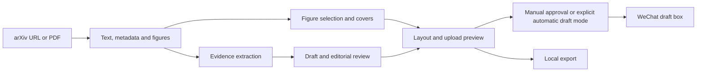

<div align="center">

# Paper Studio

**Read the paper. Build the story. Review the evidence.**

A local Windows workspace for turning research papers into illustrated WeChat articles and Xiaohongshu image notes.

[Quick Start](#quick-start) · [User Guide](docs/USAGE.md) · [Troubleshooting](docs/TROUBLESHOOTING.md) · [Privacy](SECURITY.md) · [License](#license)


</div>

Paper Studio brings paper intake, figure preparation, evidence-linked writing, editing, and WeChat draft delivery into one desktop workflow. Import an arXiv URL or a PDF, connect your own model provider, and build a Chinese research article with original figures and source information.

**Source available for noncommercial use.** This application is not offered under an OSI-approved open-source license. The surrounding AutoDrive research catalog has a separate license. See [License](#license) before using or redistributing the application.

## Features

| Stage | Capabilities |
|---|---|
| Discover | Fetch arXiv titles and links first; filter driving, world models, embodied AI, agents/RSI, AI infrastructure, and foundation-model topics. |
| Organize | Browse nine shared research categories with counts, overlapping labels, and persistent manual corrections. Existing imports are categorized locally without downloading PDFs again or using a model API. |
| Read | Extract PDF text, page references, hyperlinks, captions, tables, and image candidates; identify arXiv metadata when available. |
| Illustrate | Detect caption-based crops, extract native-resolution embedded images, import PNG/JPEG replacements, and adjust crops manually. |
| Write | Extract evidence and save an initial article, then review long drafts section by section. View pending drafts and resume saved review units after disconnects; request retries and truncated-output continuations are bounded. |
| Design | Preview the upload card and mobile article; create a wide overview cover without cropping the original diagram; optionally apply Baoyu Markdown formatting. |
| Check | Automatically prepare upload fields, cover, assets and layout. Keep evidence warnings visible and optional human review available. |
| Deliver | Send an existing article to the WeChat draft box in one action, or opt into delivery after generation, with receipts and duplicate-submission protection. |
| Share | Prepare, edit, reorder and export Xiaohongshu image notes. Automatic login and posting are temporarily disabled following a connector security alert. |
| Export | Save Markdown, HTML, structured article data, and ZIP material bundles for offline editing. |

The UI and editorial prompts currently target **Chinese-language WeChat articles**. Documentation is in English. Cover generation uses local templates and paper information; it is not a built-in image-generation model.

### Organizing your paper library

The sidebar **Research direction** (`研究方向`) filter and the discovery list use
the same categories: Autonomous Driving, World Models, Embodied AI, AI
Infrastructure Acceleration, Foundation Language Models, Agent Methods,
Recursive Self-Improvement (RSI), Video Generation, and 3D Reconstruction.
A paper may have several labels, so category counts can overlap. Category counts
cover the current library/trash or discovery list before text search; the
displayed-paper count reflects both search and category filters. Papers without
a supported match remain **Unclassified** (`待分类`).

Automatic labels are local keyword suggestions based on the title and abstract;
the specific arXiv `cs.RO` subject can also suggest Embodied AI. Existing PDF
imports use an explicit abstract near the start of the saved text when available.
The app does not scan the reference list or call a model to classify papers.
These labels are organizational hints, not verified scientific classifications
or quality scores.

Open a paper and select **Adjust categories** (`调整分类`) to choose multiple
labels. Manual choices survive restarts, renaming, and trash/restore operations;
clearing every checkbox explicitly leaves the paper unclassified. **Restore
automatic classification** switches back to suggestions. Classification changes
do not edit the article, paper metadata, generation checkpoints, or delivery
approval. Library and discovery filters only change the visible list; daily
automation topics and its existing schedule remain separate settings.

### Recovering an interrupted article

A saved initial draft appears as a read-only **pending review** preview, even when the model disconnects during editing. Use the continue action to resume unfinished work with the same paper and writing options. Completed evidence and reviewed units are retained; an existing final article is not replaced by a partial draft. The configured timeout is a connection setting, not a guarantee that a provider will keep the connection open.

Long articles use bounded review units with relevant source excerpts instead of repeatedly sending the entire article for a full rewrite. The model's configured output cap is retained; each review request can use a smaller task-specific allowance within that cap. Every unit must pass structural checks before the generation completes.

### Automatic delivery versus human review

Opting into **Generate and deliver** continues on the server after writing completes. Imported-image human-review flags are reminders in this explicit automatic draft route; readable images, valid references, account checks and upload limits still apply. The optional human-review route retains its stricter approval requirements. Automatic checks never create a human-review record, and delivery never publishes or broadcasts an article.

**Draft created, verification pending** means WeChat returned a draft ID but readback failed or differed. The tool retries transient readback failures a bounded number of times and reports which fields, text or images differ. Retrying that item only reads the existing draft; it does not upload a duplicate. An unknown create result still requires checking the WeChat backend before a new submission can be authorized.

**Long articles.** WeChat limits each article's HTML, including formatting, to fewer than 20,000 characters. Paper Studio automatically divides longer content into ordered parts in **one multi-article draft**, preserving text, figures and tables while keeping the original editable article whole. The delivery preview shows each part. Parts share the author, cover and source link; titles include their order, and multi-article digests are empty as required by the API. Uploaded image URLs are checked against the limit before creation, and every part is read back afterwards. A single oversized table or more than eight parts requires a different layout; the tool does not silently delete content. After a delivery failure, **Continue delivering the existing article** retries delivery without running the writing model again.

## Quick start

Requirements: Windows 10/11 64-bit, Python **3.11** with the `py` launcher, and Microsoft Edge WebView2 Runtime. Automated writing needs an OpenAI-compatible Chat Completions endpoint. Node.js/npm is optional for Baoyu formatting. WeChat API delivery requires your own eligible account and material/draft permissions.

```powershell
git clone https://github.com/Rtwotwo/Awesome-Autonomous-Driving-Research.git
cd Awesome-Autonomous-Driving-Research\paper-studio
powershell -NoProfile -ExecutionPolicy Bypass -File .\setup.ps1
.\start.cmd
```

Setup creates a local `.venv` and installs dependencies. It does not configure credentials, submit a draft, or enable a schedule. If Python has no launcher, create `.venv` with your Python 3.11 executable first. You can also launch with `.\.venv\Scripts\python.exe desktop.py`.

1. Open **Model settings** (`模型设置`); enter a base URL, exact model ID, and API key. Keep a separate profile for each provider/model.
2. Create a paper (`新建论文推文`) from an arXiv URL or PDF. Verify the paper-information card.
3. Check **Original text and figures** (`原文与配图`): select complete architecture diagrams, quantitative results, and qualitative examples.
4. Choose a writing emphasis and layout, then generate. Check the draft against **Evidence review** (`证据核对`).
5. Export locally, or configure WeChat and use **Automatic checks and delivery** in stage 04. Select **Prepare and check only** to inspect the result first; optional human approval remains available.

**WeChat delivery creates a draft. It never publishes or sends a mass message.** Preview and publish from the official WeChat backend. Xiaohongshu image-note design and export remain available; automatic login and posting are currently on security hold.

Model profiles include a response mode, connection/read timeout (default 600
seconds), and optional JSON-mode parameter. Streaming saves returned text as it
arrives. A transient disconnect retries the current request at most twice;
retries may consume additional provider usage. Completed evidence stages and
draft checkpoints survive. Standard JSON mode is available for providers without
streaming support. Configure the output budget to your actual provider's limits;
a larger requested maximum does not guarantee a successful response.

Completed long-form review units resume individually. Invalid JSON or known
article-schema errors receive at most two corrective requests for the current
unit; earlier units stay saved. Empty figure/table collections encoded as `0`
or `null` are normalized only when the original unit has no such attachments.
Missing images are added with a small placement-and-caption request, without
regenerating reviewed prose. Automatic draft delivery continues only after the
generation and delivery checks finish successfully.

The PDF extractor accepts captions such as `Figure 1 | Overview`. For older
zero-figure jobs, automatic illustration retries local extraction and preserves
an exactly matching writing checkpoint. Native image upgrades keep the previous
image files, and interrupted upgrades retain their checkpoint migration record.

Text-only models can still produce illustrated articles using extracted PDF
figures and captions. They cannot independently inspect visual details absent
from the extracted text. Keep image input disabled for text-only profiles.

Profiles support a complete Chat Completions URL with routing/version flags,
Bearer, `x-api-key`, or `api-key` authentication, and a per-profile system-proxy
or direct connection choice. TLS verification and redirect blocking remain on.
The connection checker sends only a small synthetic prompt. DNS, certificate,
TLS-disconnect and timeout errors are distinguished without logging raw provider
messages. A configured timeout is an upper bound, not elapsed processing time.

Declare context capacity, maximum output capacity, vision support and tool-call
support separately. These are user/provider declarations, not independently
verified capabilities. The writer uses text/optional images, not autonomous tool
calling. Large-context profiles can use the full paper within a conservative
local size limit. Automatic stage budgets reserve 32K tokens for evidence and
64K for writing when a model capacity is supplied; explicit output settings take
precedence within that capacity. Every request, including connection checks and
continuations, caps output by the declared maximum and reserves context for its
prompt/history. The preflight conservatively counts UTF-8 text bytes plus framing
and 16K per image; it is not the provider tokenizer. Oversized input is rejected
without deleting source evidence. Complete earlier stages remain recoverable.
Profiles declaring at least 500K context use 60K-character evidence chunks and
full-source writing up to 320K UTF-8 bytes; recognized official DeepSeek models
retain that large-context path even if context is undeclared. Other profiles use
18K chunks.

## Workflows

**Xiaohongshu image notes.** Stage 05 adapts a saved article into a short editable
note and up to nine 1080 × 1440 PNG cards. It preserves complete selected paper
figures, uses the overview for the cover when available, and includes source
information. This local preparation does not call a model or invent new claims.
You can change the caption, topics, image order and visibility before publishing.
Missing eligible figures produce a visible text-only warning. An independent ZIP
export supports manual posting as well.

**Connector security hold (2026-10-23).** The pinned v2.5.5 connector releases
`leakless.exe` when launching its browser. Windows Defender detected that helper
on the tested installation. Its classification has not been independently resolved.
Installation, login, and automatic posting are disabled; do not restore quarantined
files, add antivirus exclusions, or disable protection. Health checks alone did
not test browser launch and were insufficient to validate the previous integration.

Use **Download image-note ZIP** in stage 05, then upload the extracted images and
text through the [official creator platform](https://creator.xiaohongshu.com/).
See [Xiaohongshu status and manual workflow](docs/XIAOHONGSHU.md). A replacement
requires a reviewed browser launch chain and an end-to-end QR-login check with
antivirus protection enabled. No replacement has been validated yet.

The companion is [xiaohongshu-mcp v2.5.5](https://github.com/xpzouying/xiaohongshu-mcp/releases/tag/v2.5.5),
an independent browser automation project, not an official personal-account
publishing API. Paper Studio verifies the executable checksum, binds the service
to loopback, and keeps its random access token in the backend. The upstream
response does not provide a verified note ID: the receipt therefore says
**submitted, verification required**. Inspect the creator backend before retrying
an uncertain attempt. A disconnected request is never retried automatically.
See [the Xiaohongshu guide](docs/XIAOHONGSHU.md) for setup and troubleshooting.

**Automatic delivery desk.** For a saved article, one action prepares the title
and short card digest, selects an overview cover, validates the upload, transfers
images, and creates a WeChat draft. No model is needed to deliver an existing
article. Paper Studio is the default editorial byline; saved custom or blank bylines
are preserved. A manually selected cover is preserved as well. Overview covers
fit the complete original figure into a wide canvas; fallback choices are
identified in the interface. Mechanical checks do not certify scientific claims
or create a human-review signature. Evidence warnings stay visible for review
in the draft box. Missing or unusable assets, invalid payloads and unresolved
prior submissions still stop delivery.

**Manual editing.** Import, generate, edit, review, and submit. Changes to the article, images, upload fields, layout, or target account invalidate prior approval.

**Direct arXiv-to-draft.** Explicitly select a paper for generation and draft delivery. This bypasses the discovery batch's repository-screening requirement for that user-selected paper, while retaining document, evidence, illustration, and upload-readiness checks. Review the result in WeChat afterwards.

**Discovery batches.** Metadata appears before expensive downloads. Processing is serial: complete the current paper before downloading the next. Stop immediately or finish the current article and stop. Automatic processing is disabled by default, deduplicates known papers, and defaults to five unattended batch attempts per Beijing-calendar day. Explicitly selected manual paper runs are outside that unattended quota. No eligible paper means no article. Failed resource or content checks hold the item for intervention.

Discovery covers autonomous driving, world models, embodied intelligence,
foundation/language models, agents, recursive improvement, video generation,
3D reconstruction and AI infrastructure acceleration. Eight arXiv query groups
cover initial publications in the last seven UTC days, with up to 100 records
per group. New versions of older papers are excluded. Optional AlphaXiv
public-page discovery contributes up to 25 paper IDs, validated against arXiv
metadata. This bounded search is not an exhaustive literature survey. See the
[arXiv API manual](https://info.arxiv.org/help/api/user-manual.html) and the
[AlphaXiv public discovery page](https://www.alphaxiv.org/).

The list explains its reading priority: topic relevance, informative method and
evaluation descriptions, author-provided resource leads, and explicit author
affiliations matching a documented preference list in `research_priority.py`.
The lexical reading-priority score is computed before repository verification;
publication date breaks ties. It is not a scientific quality score. Mentioning a prestigious lab in an abstract
does not establish an author affiliation; missing institutions remain eligible.
Unattended writing still requires independently matched project and released-code
evidence. Every model/vendor profile and credential remains outside Git.

The application exposes `--autofeed-run` and `--autofeed-discover`; **no always-on scheduler is bundled**. An external local scheduler can invoke them after you configure and enable the batch. The computer must be awake and connected. Installation does not enable existing paused schedules.

## Data and credentials

Fresh source and development-binary launches keep runtime data outside the checkout:

```text
%LOCALAPPDATA%\PaperStudio\
├── data\          Papers, drafts, evidence, and receipts
├── settings\      Optional Windows-user-encrypted credentials
├── exports\       Article bundles
├── automation\    Discovery state and queue settings
└── connectors\    Optional Xiaohongshu companion and private login session
```

Set `PAPER_STUDIO_HOME` to an absolute private directory **outside the source tree** to override this location. Legacy private installations can retain their existing configuration. Do not use a public repository or shared sync folder for runtime data.

- Model and WeChat secrets can use Windows DPAPI persistence, bound to the current user, or remain memory-only.
- Xiaohongshu browser cookies are stored by the companion in its private `session/cookies.json`; they are **not DPAPI-encrypted**. Keep this directory out of Git and cloud sync. The application never asks for your Xiaohongshu password.
- The desktop service binds to `127.0.0.1` and requires a per-launch session. It is not a hosted web application.
- Local storage does **not** mean offline inference: writing sends paper text and optional images to the selected provider; draft submission uploads content to WeChat.
- This release contains no real credentials, private account settings, paper PDFs, manuscripts, or runtime logs.

See [SECURITY.md](SECURITY.md) for privacy boundaries and safe issue reporting.

## Optional formatting

```powershell
powershell -NoProfile -ExecutionPolicy Bypass -File .\setup-formatter.ps1
```

The optional formatter uses the MIT-licensed [Baoyu skill](skills/baoyu-markdown-to-html/SKILL.md) and a separately installed Bun runtime. Its npm dependencies may download on first use. Apply formatting before approval; the upload preview reflects the selected layout. Built-in layouts work without Node.js/Bun.

## Architecture



The PDF backend uses **pdfplumber**, **pypdfium2/PDFium**, and **pypdf**; it does not depend on PyMuPDF. Internal evidence references remain separate from reader-facing prose.

| Module | Responsibility |
|---|---|
| `desktop.py`, `desktop_window.py` | Lifecycle, single-instance activation, private data root |
| `server.py`, `static/` | Authenticated local API and editor |
| `pdf_backend.py`, `sources.py`, `materials.py` | PDF interpretation, cropping, image preparation |
| `writing.py`, `figure_plan.py`, `publication.py` | Model pipeline, illustration coverage, article structure |
| `formatting.py`, `covers.py`, `exporting.py` | Layouts, covers, exports |
| `wechat_review.py`, `wechat_fields.py`, `wechat_content.py`, `wechat_api.py` | Review snapshots, upload fields, lossless parts, draft delivery |
| `feed_sources.py`, `autofeed.py` | Discovery, resource verification, serial queues |

## Development

```powershell
.\.venv\Scripts\python.exe -m pip install -r requirements-dev.txt
.\.venv\Scripts\python.exe -X utf8 -m unittest discover -s tests -v
.\.venv\Scripts\python.exe desktop.py --self-test --result "$env:TEMP\paper-studio-selftest.json"
powershell -NoProfile -ExecutionPolicy Bypass -File .\build-desktop.ps1
```

Tests use synthetic papers and mocked external APIs. They check workflow behavior, credential isolation, continuation, crops, review invalidation, and receipts; they do not certify scientific claims. Build output is `dist\PaperStudio\PaperStudio.exe`. This repository distributes source, not a signed Windows installer. Build and runtime directories are ignored by Git.

## Limitations

- Scanned PDFs need external OCR; unusual captions and multi-panel figures may need manual cropping.
- Resource checks can miss an official repository. A project-only README does not prove code has been released.
- Evidence matching cannot establish that a claim is true. Verify comparisons, conditions, numbers, and captions.
- WeChat permissions, IP allowlists, upload limits, and connectivity can block delivery. An AppID alone does not establish draft permission.
- Local videos are exported as materials/source cards; insert and verify them in WeChat. They do not upload with HTML.
- Ambiguous submission timeouts require reconciliation instead of automatically creating another draft.

## License

Original Paper Studio code and documentation are licensed under **[PolyForm Noncommercial 1.0.0](LICENSE)**. Commercial use requires separate permission from the rights holder. This is source-available software, not unrestricted open source. The full license defines permitted purposes, organizational uses, and redistribution obligations.

Required Notice: Copyright (c) 2026 Rtwotwo and Paper Studio contributors.

The AutoDrive catalog outside this directory retains its [Apache-2.0 license](../LICENSE). Third-party components, including the vendored formatter, retain their own licenses; the noncommercial terms do not replace them. See [THIRD_PARTY_NOTICES.md](THIRD_PARTY_NOTICES.md).
